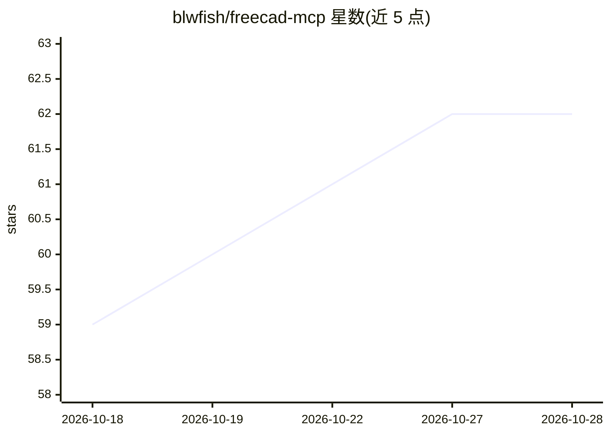

# blwfish/freecad-mcp

⭐ 62 · Python · LGPL-2.1 · 推送 2026-10-26 · [GitHub](https://github.com/blwfish/freecad-mcp) · 个人维护

**连接 AI agent 与 FreeCAD 的 MCP 服务器，含 32 个 CAD 工具**

在 AI agent 与 FreeCAD 之间提供桥接的 MCP 服务器：通过 socket 与 FreeCAD 内的 AICopilot 工作台通信，暴露 32 个工具，支持参数化建模、草图约束诊断、CAM 刀路生成、网格处理、STEP/G-code 导出等。支持多 FreeCAD 实例发现与切换，内置操作日志、崩溃捕获等诊断设施，含 1430 个单元测试与集成测试。限制：CAM 工具需 FreeCAD weekly 开发版；安全上授予 agent 对 FreeCAD Python 环境的完整访问。面向使用 Claude Code 等 MCP 客户端的 CAD 用户与开发者。

## 筛选速览

| 维度 | 判定 | 备注 |
|---|---|---|
| AI 角色 | `ai-ecosystem` | LLM/agent 周边工具 |
| 许可风险 | `viral` | LGPL-2.1 |
| 部署形态 | `None` |  |
| 模型依赖 | locked-api |  |
| 硬件要求 | — | 无带数字的原话,不猜 |
| 安装摩擦 | `low` | 无编译、无系统依赖或容器化 |
| 成熟度 | — | 结构信号不足 |

## 能力要点

- 32 个工具覆盖建模、草图诊断、CAM 刀路与 G-code 导出
- 多 FreeCAD 实例（GUI/headless）发现、选择与生成
- 操作日志、崩溃捕获与 Report View 访问等诊断设施
- 1430 个单元测试与端到端集成测试，CI 每次 push 运行

## 适用场景

- 让 AI agent 协同完成参数化零件设计与迭代
- 解读 FreeCAD 报错、检查几何错误与壁厚可打印性
- 规划 CNC 刀路并导出 STEP 与 G-code
- 编写由尺寸表驱动的可复用宏生成工作流

## 场景标签

 · 领域:工程/CAD 工具链

## 证据(README 行号)

> L9: This is a bridge between your AI agent and FreeCAD — a thinking partner for parametric design, CNC toolpath generati
> L45: Developed on macOS with Claude Code. The code handles macOS, Windows, and Linux — other platforms *should* work but
> L63: - **Socket server started / Claude ready** — the bridge is listening. This is the line that means your AI agent can

## 星数曲线

2026-10-18 59 → 2026-10-28 62（+3）

---
*卡片 v1 · prompt 1.4 · 生成 2026-10-24 · 置信度 high · 依据 README sha `dcc301f059d8` · [字段定义](../../DATASET.md)*
