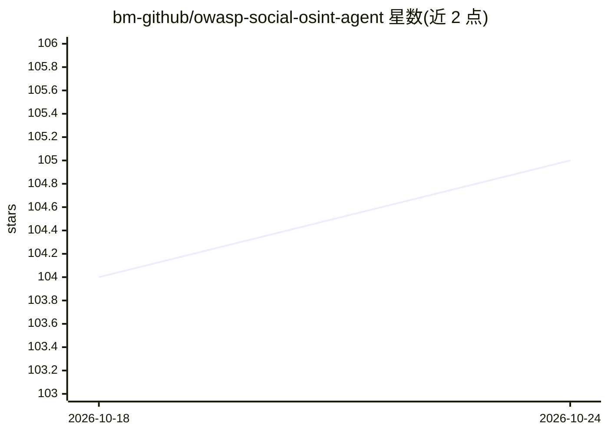

# bm-github/owasp-social-osint-agent

⭐ 105 · Python · MIT · 推送 2026-04-25 · [GitHub](https://github.com/bm-github/owasp-social-osint-agent) · 组织维护

**面向社交媒体开源情报调查的自主 OSINT 分析代理**

OWASP Social OSINT Agent 是一个自主代理，通过任意 OpenAI 兼容 API 调用文本与视觉 LLM，跨 Twitter/X、Reddit、Bluesky、GitHub、Hacker News、Mastodon 六个平台采集目标用户公开数据，两阶段执行（先全量抓取文本与媒体，再做视觉分析），生成结构化分析报告，包含联系人网络图、Pattern of Life 热力图、实体抽取（位置/邮箱/电话/加密货币地址/别名）与共享域名统计。提供 Web 界面（端口 8000，支持 Basic Auth）与 CLI 双前端，数据目录相互隔离。采用 XML 标签包裹不可信社媒数据以缓解间接提示注入，支持 24 小时缓存、离线模式与 Docker 容器化部署。

## 筛选速览

| 维度 | 判定 | 备注 |
|---|---|---|
| AI 角色 | `ai-native` | 本体是模型或模型工具 |
| 许可风险 | `permissive` | MIT |
| 部署形态 | `self-host` | docker 或自建部署 |
| 模型依赖 | — | README 未给出锁定关系 |
| 硬件要求 | — | 无带数字的原话,不猜 |
| 安装摩擦 | `low` | 无编译、无系统依赖或容器化 |
| 成熟度 | — | 结构信号不足 |

## 能力要点

- 六平台多目标数据采集与跨账号对比分析
- 两阶段流水线：全量抓取后集中执行视觉 LLM 图像分析
- 用 XML 标签隔离不可信社媒数据以缓解间接提示注入
- Web UI 提供会话管理、D3 网络图、时间线热力图与实体抽取面板

## 适用场景

- 对多个社交平台账号开展开源情报调查并生成综合报告
- 通过联系人网络发现扩展调查目标
- 在浏览器中管理调查会话、缓存与历史报告

## 场景标签

`网络安全` · 领域:学习与行业

## 证据(README 行号)

> L6: **OWASP Social OSINT Agent** is an intelligent, autonomous agent designed for open-source intelligence (OSINT) inves
> L40: ✅ **AI-Powered Analysis:** Utilises configurable models via OpenAI-compatible APIs for sophisticated text and image

## 星数曲线

2026-10-18 104 → 2026-10-24 105（+1）

---
*卡片 v1 · prompt 1.4 · 生成 2026-10-23 · 置信度 mid · 依据 README sha `daf7c5475a9b` · [字段定义](../../DATASET.md)*
