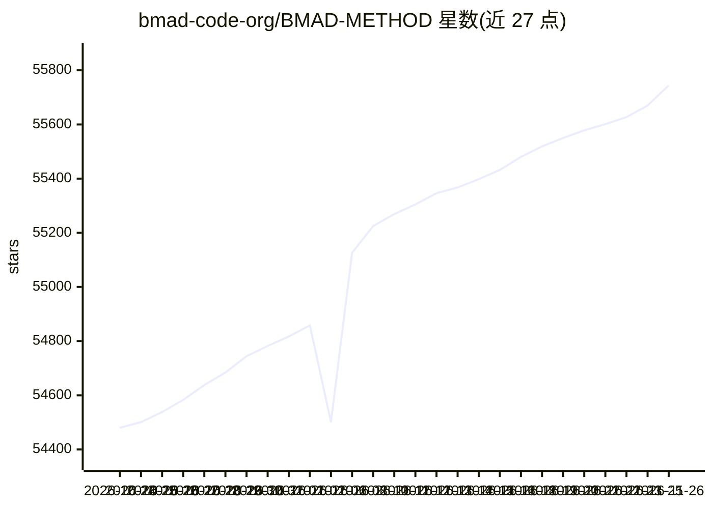

# bmad-code-org/BMAD-METHOD

⭐ 55,744 · Python · NOASSERTION · 推送 2026-11-25 · [GitHub](https://github.com/bmad-code-org/BMAD-METHOD) · 组织维护

**为开发者提供 AI 驱动的敏捷软件开发方法论与工作流**

BMad Method 是一套开源的敏捷 AI 驱动开发（AiDD）方法，覆盖从需求澄清、规划到构建与验证的完整交付循环，通过 agents 和结构化工作流把关键决策显式化并作为上下文延续，避免每个会话重复解释。以 npm 安装器分发到用户的 AI 编码工具中，作为 skills 模块运行；需要 Node.js 20.12+、Python 3.10+ 与 uv。当前稳定版 v6.12，v7 处于 preview alpha，存在破坏性变更。

## 筛选速览

| 维度 | 判定 | 备注 |
|---|---|---|
| AI 角色 | `ai-ecosystem` | LLM/agent 周边工具 |
| 许可风险 | `permissive` | NOASSERTION |
| 部署形态 | `library` | 以包/库形式分发 |
| 模型依赖 | — | README 未给出锁定关系 |
| 硬件要求 | — | 无带数字的原话,不猜 |
| 安装摩擦 | `low` | 无编译、无系统依赖或容器化 |
| 成熟度 | `idea` | |

## 动量与使用信号

- 维护:`active` — 距上次 push 0.8 天,年发版 35,154 位贡献者
- 涨星:近 1 天 **+56**(自 20261016 起算)
- 安装:npm 包 `bmad-method` 月下载 76,157

## 能力要点

- 通过 npx 安装 skills 模块到支持的 AI 编码工具
- 提供 bmad-build、bmad-help、bmad setup 等核心技能与命令
- 可选模块扩展：Founder 创业顾问、Test Architect、Game Dev Studio 等
- 按变更规模自适应流程深度：小改动直达构建，复杂工作深度规划

## 适用场景

- 在 AI 编码工具中按敏捷流程管理需求澄清与规划
- 在既有代码库上建立持久化上下文继续开发
- 为游戏项目提供跨 Unity/Unreal/Godot 等框架的构建流程

## 场景标签

`编码 Agent` · 领域:编码与开发

## 证据(README 行号)

> L7: **Agile Ai Driven Development — turn an idea or change request into working software without giving up the thinking.
> L9: Ai Driven Development (AiDD) covers the whole effort, not only the code: what to build, how it holds together, and h
> L31: Expect breaking changes between updates. You need an AI coding tool that supports skills.

## 星数曲线

2026-10-24 54,480 → 2026-11-26 55,744（+1,264）

---
*卡片 v1 · prompt 1.4 · 生成 2026-11-22 · 置信度 high · 依据 README sha `6c29fff57dda` · [字段定义](../../DATASET.md)*
