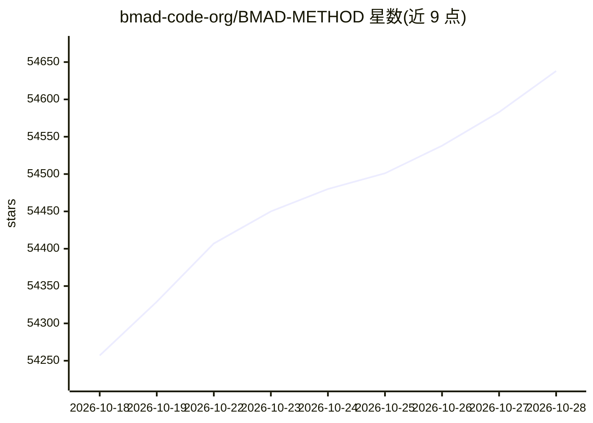

# bmad-code-org/BMAD-METHOD

⭐ 54,684 · Python · NOASSERTION · 推送 2026-10-27 · [GitHub](https://github.com/bmad-code-org/BMAD-METHOD) · 组织维护

**面向 AI 编码工具的敏捷 AI 驱动开发方法论与技能集**

BMad Method 是一套 Agile AI 驱动开发（AiDD）方法论：以技能、工作流和多 agent 形式安装到 AI 编码工具中，将想法或变更请求经 Clarify、Plan、Build、Learn 循环转化为可用软件，并强调决策显式化与上下文持续承载。提供稳定版 v6.12（npm 安装器）与 V7 预览 alpha（skills CLI 或 Claude Code/Codex 插件市场）两条路线，均需 uv 与 Python 脚本，V7 需支持 skills 的编码工具且会有破坏性变更。另有测试架构、游戏开发等官方模块生态。

## 筛选速览

| 维度 | 判定 | 备注 |
|---|---|---|
| AI 角色 | `ai-ecosystem` | LLM/agent 周边工具 |
| 许可风险 | `permissive` | NOASSERTION |
| 部署形态 | `library` | 以包/库形式分发 |
| 模型依赖 | — | README 未给出锁定关系 |
| 硬件要求 | — | 无带数字的原话,不猜 |
| 安装摩擦 | `low` | 无编译、无系统依赖或容器化 |
| 成熟度 | `idea` | |

## 动量与使用信号

- 维护:`active` — 距上次 push 0.8 天,年发版 35,154 位贡献者
- 涨星:近 1 天 **+56**(自 20261016 起算)
- 安装:npm 包 `bmad-method` 月下载 76,157

## 能力要点

- 双发布线：稳定版 v6.12（npm 安装）与 V7 预览 alpha（skills CLI/插件市场）
- Clarify/Plan/Build/Learn 交付循环，流程按变更规模自适应
- 多 agent 角色分工（产品/架构/UX/开发/测试）与持久化上下文
- 6 个官方生态模块（Builder、Test Architect、Game Dev Studio 等）

## 适用场景

- 在 AI 编码工具中用结构化流程把想法落地为软件
- 给接手的既有代码库建立已验证的上下文
- 小团队按敏捷方式管理 AI 参与的软件交付

## 场景标签

`多智能体` `编码 Agent` · 领域:Agent 开发

## 证据(README 行号)

> L7: **Agile Ai Driven Development — turn an idea or change request into working software without giving up the thinking.
> L24: npx bmad-method install
> L56: Open your coding tool in the project and ask the `bmad` skill to run

## 星数曲线

2026-10-18 54,257 → 2026-10-28 54,638（+381）

---
*卡片 v1 · prompt 1.4 · 生成 2026-10-20 · 置信度 high · 依据 README sha `d6444b1e05ae` · [字段定义](../../DATASET.md)*
