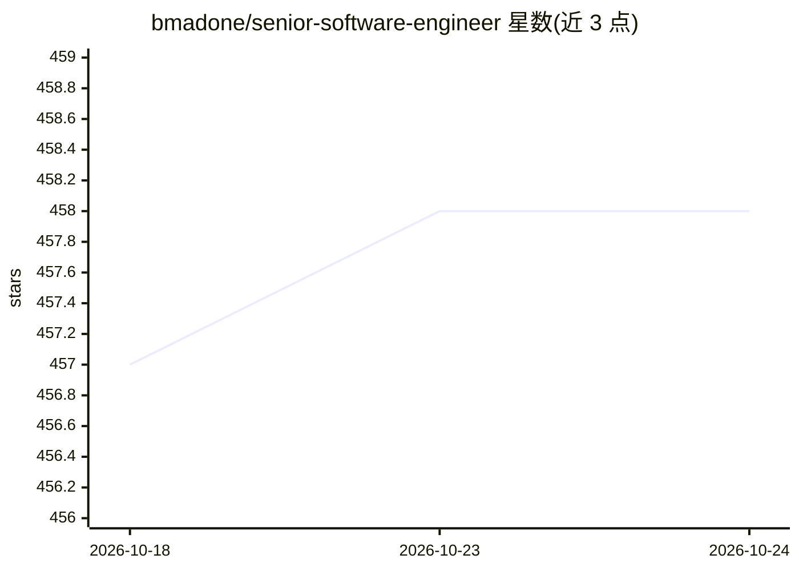

# bmadone/senior-software-engineer

⭐ 458 · 推送 2026-05-09 · [GitHub](https://github.com/bmadone/senior-software-engineer) · 个人维护

**高级软件工程师面试与晋升准备的资源合集**

汇编文章、书籍与建议，覆盖编程范式、架构、模式、CI/CD、SDLC、安全、软技能、算法与系统设计、行为面试及 AI 与 LLM 等主题，面向准备高级工程师面试、内部评估或 staff 级晋升的工程师。指南创建于 2022 年并更新：讨论 AI 工具（Copilot、Claude、Cursor）普及后高级工程师的定位，新增 AI & LLMs 主题，并收录 GitOps、平台工程、OWASP LLM Top 10、HTTP/3 等近年变化。纯阅读材料，无安装运行方式。

## 筛选速览

| 维度 | 判定 | 备注 |
|---|---|---|
| AI 角色 | `ai-knowledge` | 知识聚合/清单类 |
| 许可风险 | `none` | — |
| 部署形态 | `None` |  |
| 模型依赖 | — | README 未给出锁定关系 |
| 硬件要求 | — | 无带数字的原话,不猜 |
| 安装摩擦 | `low` | 无编译、无系统依赖或容器化 |
| 成熟度 | — | 结构信号不足 |

## 能力要点

- 覆盖 15 个主题的面试与晋升资源清单
- 专设章节讨论 AI 存在时代高级工程师的定义
- 新增 AI & LLMs 主题与 AI 安全（Prompt injection、OWASP LLM Top 10）内容
- 自 2022 年起持续更新行业变化（GitOps、平台工程、HTTP/3）

## 适用场景

- 准备高级软件工程师面试或内部评估
- 准备 staff 级晋升答辩
- 了解 AI 工具普及后资深工程师的能力要求

## 场景标签

`精选清单` · 领域:学习与行业

## 证据(README 行号)

> L3: Resources to prepare for senior-level software engineering interviews, internal assessments, and staff-level promoti
> L20: - AI & LLMs

## 星数曲线

2026-10-18 457 → 2026-10-24 458（+1）

---
*卡片 v1 · prompt 1.4 · 生成 2026-10-21 · 置信度 high · 依据 README sha `7bab7e685fa3` · [字段定义](../../DATASET.md)*
