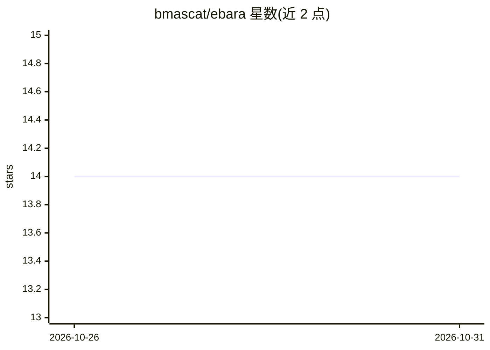

# bmascat/ebara

⭐ 14 · Python · GPL-3.0 · 推送 2026-10-26 · [GitHub](https://github.com/bmascat/ebara) · 个人维护

**循证医学文献检索助手：自然语言查 PubMed 并生成带引用回答**

面向生物医学研究者与医疗从业者的循证文献检索工具：用 LLM 将自然语言问题转为 PubMed 高级检索式，经 PyMed 拉取摘要，Hugging Face Transformers 生成嵌入并建立 FAISS 向量索引，再由 LLM 生成含引用的循证回答；查询、回答与上下文存入 SQLite 供审计。默认通过本地 Ollama 运行 LLM（如 llama3.2），OpenAI API 为可选云端后端。提供 CLI、Streamlit 网页与 FastAPI 接口三种使用方式，Docker Compose 可一键部署。硬件要求 16GB 内存与 i5 处理器，GPU 可改善体验。

## 筛选速览

| 维度 | 判定 | 备注 |
|---|---|---|
| AI 角色 | `ai-native` | 本体是模型或模型工具 |
| 许可风险 | `viral` | GPL-3.0 |
| 部署形态 | `self-host` | docker 或自建部署 |
| 模型依赖 | local-ok | 支持本地模型 |
| 硬件要求 | — | 无带数字的原话,不猜 |
| 安装摩擦 | `low` | 无编译、无系统依赖或容器化 |
| 成熟度 | — | 结构信号不足 |

## 能力要点

- 自然语言问题自动转 PubMed 高级检索式
- Transformers 嵌入 + FAISS 向量索引做摘要语义检索
- 生成含引用的循证回答，SQLite 存储查询历史供审计
- 默认本地 Ollama 生成，OpenAI API 为可选云端后端

## 适用场景

- 用自然语言提问快速检索疾病、治疗与药物相关文献
- 文献综述时获得带 PubMed 摘要引用的循证回答
- 回溯和审计历史查询及其引用上下文

## 场景标签

`语义搜索` `科研工具` `文档问答` · 领域:知识与检索

## 证据(README 行号)

> L11: The Evidence-Based AI Research Assistant (EBARA) is a tool designed to assist researchers and healthcare profession
> L131: - **Advanced Query Generation:** Converts user questions into optimized PubMed search queries.

## 星数曲线

2026-10-26 14 → 2026-10-31 14（+0）

---
*卡片 v1 · prompt 1.4 · 生成 2026-10-31 · 置信度 mid · 依据 README sha `995c6dd07d89` · [字段定义](../../DATASET.md)*
