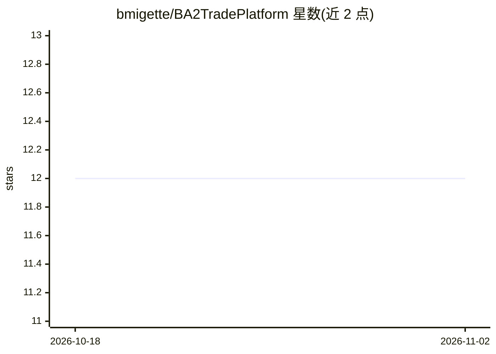

# bmigette/BA2TradePlatform

⭐ 12 · Python · NOASSERTION · 推送 2026-10-29 · [GitHub](https://github.com/bmigette/BA2TradePlatform) · 个人维护

**算法交易平台：多专家自动交易与回测优化（Alpha）**

Python 单仓多包结构的算法交易平台，含两个应用：ba2-trade 是 NiceGUI 实盘 Web 应用，以市场专家舰队对接 Alpaca/TastyTrade/IBKR 券商账户，通过规则集驱动交易动作，风险管理模式分 classic 与 AI（LangGraph agent）两种；ba2-test 是 FastAPI + React 回测与优化平台，用遗传算法搜索专家参数并对获胜策略做压力测试，另含深度学习预测模块。两者共用同一套专家/Provider 代码，使回测结果对实盘有预测性。项目自声明为 Alpha 阶段不稳定，明确不适用于生产交易。

## 筛选速览

| 维度 | 判定 | 备注 |
|---|---|---|
| AI 角色 | `ai-enhanced` | 去掉 AI 部分产品仍成立 |
| 许可风险 | `none` | NOASSERTION |
| 部署形态 | `desktop` | 安装包/桌面程序 |
| 模型依赖 | — | README 未给出锁定关系 |
| 硬件要求 | `cpu-ok` | |
| 安装摩擦 | `low` | 无编译、无系统依赖或容器化 |
| 成熟度 | `idea` | |

## 能力要点

- 规则集（触发器+动作）驱动的半自动/全自动交易，含期权结构交易动作
- ba2-test 用遗传算法优化专家参数并做压力测试
- classic 与 smart（LangGraph agent）两种风险管理模式
- 实盘与回测共用同一套专家/Provider 代码，支持离线重放对比

## 适用场景

- 我想用可自定义进出场规则的专家策略做自动化交易
- 我想用遗传算法回测并优化交易策略参数
- 我想在实盘前用模拟交易验证平台与策略

## 场景标签

`金融量化` · 领域:学习与行业

## 证据(README 行号)

> L5: - **ba2-trade** (repo root) — the live trader: a NiceGUI web app that runs a fleet of market experts against broker 
> L173: - **Smart Risk Manager** (`smart`): a LangGraph agent that manages the expert's portfolio with the

## 星数曲线

2026-10-18 12 → 2026-11-02 12（+0）

---
*卡片 v1 · prompt 1.4 · 生成 2026-11-01 · 置信度 low · 依据 README sha `e17fea8b127a` · [字段定义](../../DATASET.md)*
