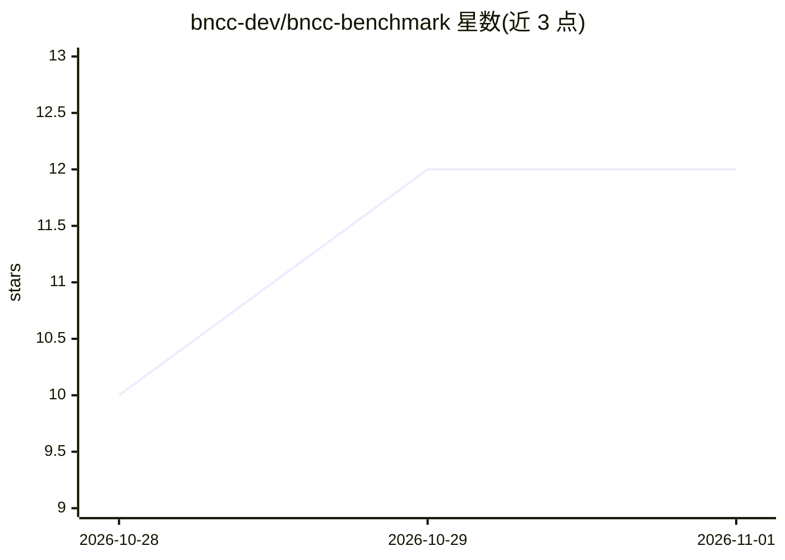

# bncc-dev/bncc-benchmark

⭐ 12 · TypeScript · NOASSERTION · 推送 2026-09-19 · [GitHub](https://github.com/bncc-dev/bncc-benchmark) · [官网](https://bncc.dev) · 组织维护

**测量 LLM 在巴西国家课程(BNCC)上幻觉的公开评测基准**

针对 BNCC（巴西国家共同课程基础）的 LLM 幻觉公开基准：以四类任务（直接查取、存在性判断、开放生成、反向查取）测量模型在无结构化来源时编造课程代码与文本的程度，官方轮次覆盖 19 个模型 × 900 题共 17,100 条原始回答，采用直连各家 API 与批量执行。含 grounding 干预研究（对比无源/贴入 prompt/查询 MCP 三种条件的幻觉率）与不公开的 held-out 私有集以对抗训练污染。由 bncc.dev（Profy 维护）出品，声明了利益冲突并提供完整方法论与可复算数据。

## 筛选速览

| 维度 | 判定 | 备注 |
|---|---|---|
| AI 角色 | `ai-ecosystem` | LLM/agent 周边工具 |
| 许可风险 | `none` | NOASSERTION |
| 部署形态 | `library` | 以包/库形式分发 |
| 模型依赖 | — | README 未给出锁定关系 |
| 硬件要求 | — | 无带数字的原话,不猜 |
| 安装摩擦 | `low` | 无编译、无系统依赖或容器化 |
| 成熟度 | — | 结构信号不足 |

## 能力要点

- 官方轮次 19 模型 × 900 题，17,100 条原始回答全部公开
- 四类幻觉测量任务 + 五维度评分
- held-out 私有题集防训练污染，结果集不可变
- grounding 干预研究：无源 31.9% / 贴 prompt 0.2% / MCP 2.3%

## 适用场景

- 评估 LLM 在巴西 K12 课程知识上的忠实度
- 研究 grounding（MCP / 上下文注入）对幻觉率的影响
- 选取教育类应用所需的模型参考数据

## 场景标签

`模型评测` · 领域:评测与运维

## 证据(README 行号)

> L8: Benchmark público de alucinação de LLMs sobre a BNCC (Base Nacional Comum
> L14: A rodada `oficial-seca-2026-09` mediu **19 modelos × 900 respostas cada**, e as
> L140: harness/          código do benchmark (gerador de itens, runner, avaliação, agregação)

## 星数曲线

2026-10-28 10 → 2026-11-01 12（+2）

---
*卡片 v1 · prompt 1.4 · 生成 2026-11-01 · 置信度 high · 依据 README sha `f4ae4d974ae8` · [字段定义](../../DATASET.md)*
