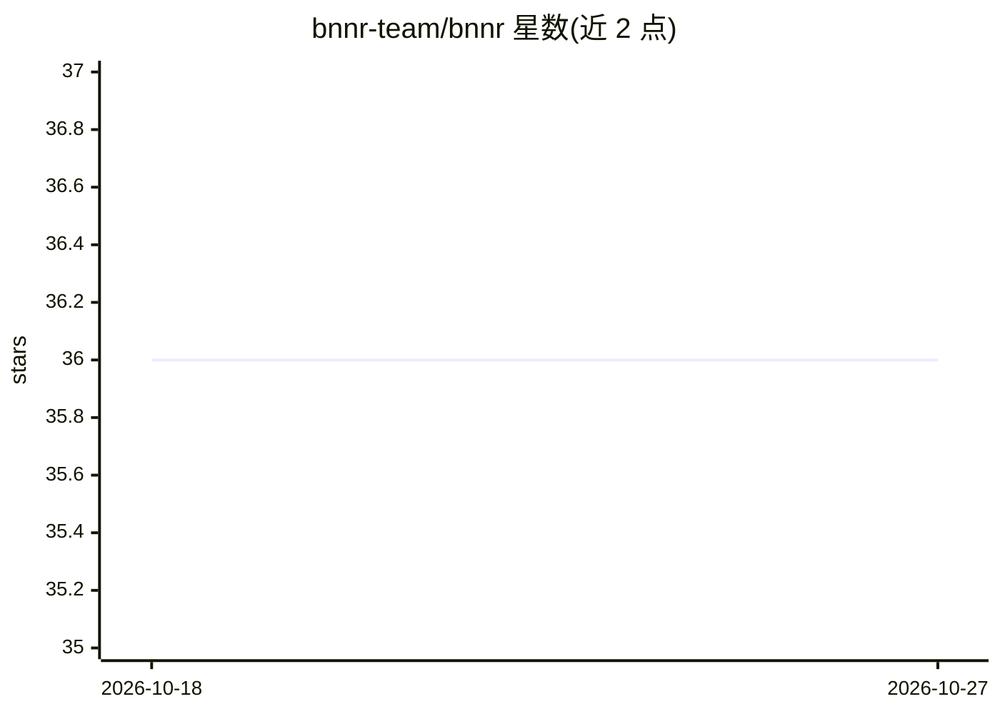

# bnnr-team/bnnr

⭐ 36 · Python · MIT · 推送 2026-10-21 · [GitHub](https://github.com/bnnr-team/bnnr) · [官网](https://www.bnnr.dev/) · 组织维护

**面向 PyTorch 视觉模型的 XAI 诊断与显著性引导增强工具包**

PyTorch 计算机视觉工具包：`bnrr analyze` 对已训练 checkpoint 无需重训即生成自包含 HTML 失败报告（混淆矩阵、OptiCAM 显著性叠加、建议）与结构化 JSON 审计产物；训练管线用 Grad-CAM 显著性图驱动 ICD/AICD 增强，经分支搜索仅保留可度量提升验证指标的增强组合。支持单标签/多标签分类与目标检测（YOLO/COCO-mini），带实时 dashboard。MIT 许可，软件与方法均有 Zenodo DOI。

## 筛选速览

| 维度 | 判定 | 备注 |
|---|---|---|
| AI 角色 | `ai-ecosystem` | LLM/agent 周边工具 |
| 许可风险 | `permissive` | MIT |
| 部署形态 | `library` | 以包/库形式分发 |
| 模型依赖 | — | README 未给出锁定关系 |
| 硬件要求 | — | 无带数字的原话,不猜 |
| 安装摩擦 | `low` | 无编译、无系统依赖或容器化 |
| 成熟度 | — | 结构信号不足 |

## 能力要点

- 对已有 checkpoint 免重训生成 XAI 失败报告（HTML + JSON 审计产物）
- ICD/AICD：由同一显著性图导出的两种相反增强策略，掩块填充可配置
- 分支搜索仅保留可度量提升验证指标的增强
- 支持多标签分类与目标检测（YOLO 集成），提供实时训练 dashboard

## 适用场景

- 我有训练好的视觉模型，想看它出错时到底在看哪里
- 用显著性引导的增强替代随机猜测式数据增强
- 向评审或合规方提供可附带的模型质量审计报告

## 场景标签

 · 领域:计算机视觉/可解释 AI 工具

## 证据(README 行号)

> L28: **An HTML failure report for any PyTorch vision checkpoint — see _where_ your model looks when it's wrong, then fix
> L30: Run `bnnr analyze` on a trained model and you get a self-contained HTML report: confusion matrix, top confused pair
> L129: - **XAI-driven augmentation (ICD / AICD)** — augmentations guided by saliency maps; no other PyTorch toolkit combi

## 星数曲线

2026-10-18 36 → 2026-10-27 36（+0）

---
*卡片 v1 · prompt 1.4 · 生成 2026-10-25 · 置信度 high · 依据 README sha `5be29f689d99` · [字段定义](../../DATASET.md)*
