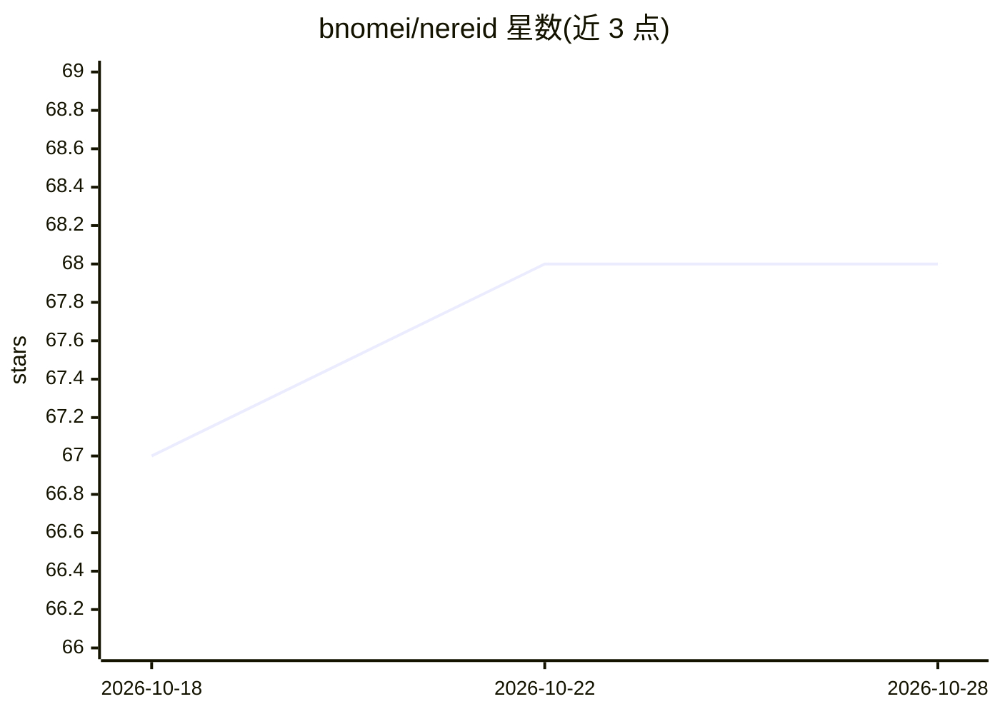

# bnomei/nereid

⭐ 68 · Rust · NOASSERTION · 推送 2026-07-11 · [GitHub](https://github.com/bnomei/nereid) · [官网](https://crates.io/crates/nereid) · 个人维护

**终端优先的 Mermaid 图工作区：TUI + MCP 服务器，人与 AI agent 共同编辑图表**

基于 ratatui 的终端工作区，用于浏览与编辑时序图、流程图、类图、ER 图和甘特图。核心机制：内置 MCP 服务器通过 Streamable HTTP 或 stdio 暴露类型化工具，供 AI agent 导航、结构化变更、交叉引用查询；会话以文件夹为持久化载体（.mmd 源文件 + 元数据 + 文本渲染导出）；支持指纹匹配时保持身份的 Mermaid 源码 reconcile。许可证为 source-available 仅限非商业使用，商业使用需另行书面许可。提供 Cargo、Homebrew、npm 包装器、Docker 等安装方式。

## 筛选速览

| 维度 | 判定 | 备注 |
|---|---|---|
| AI 角色 | `ai-ecosystem` | LLM/agent 周边工具 |
| 许可风险 | `none` | NOASSERTION |
| 部署形态 | `self-host` | docker 或自建部署 |
| 模型依赖 | — | README 未给出锁定关系 |
| 硬件要求 | — | 无带数字的原话,不猜 |
| 安装摩擦 | `low` | 无编译、无系统依赖或容器化 |
| 成熟度 | — | 结构信号不足 |

## 能力要点

- 内置 MCP 服务器（HTTP/stdio 双传输）暴露类型化图表工具
- 支持时序/流程/类/ER/甘特五类图，不支持的语法报可操作错误
- 指纹匹配时进行保持身份的 Mermaid 源码 reconcile
- 会话文件夹持久化：.mmd 源、元数据索引、walkthrough 与文本渲染导出

## 适用场景

- 在终端中浏览和编辑 Mermaid 图并保持文件化工作流
- 让 AI agent 通过 MCP 工具共同查看和修改图表会话
- 对现有 Mermaid 源做批量改写并追踪悬空交叉引用

## 场景标签

 · 领域:开发工具/图表

## 证据(README 行号)

> L11: Nereid is a terminal-first workspace for Mermaid-backed diagrams. It combines a `ratatui` TUI, a Model Context Prot
> L17: - expose typed MCP tools for diagram navigation, structured mutation (including sequence blocks), xrefs, walkthroug
> L274: Nereid exposes MCP tools for live diagram collaboration.

## 星数曲线

2026-10-18 67 → 2026-10-28 68（+1）

---
*卡片 v1 · prompt 1.4 · 生成 2026-10-24 · 置信度 high · 依据 README sha `0fbb862332b1` · [字段定义](../../DATASET.md)*
