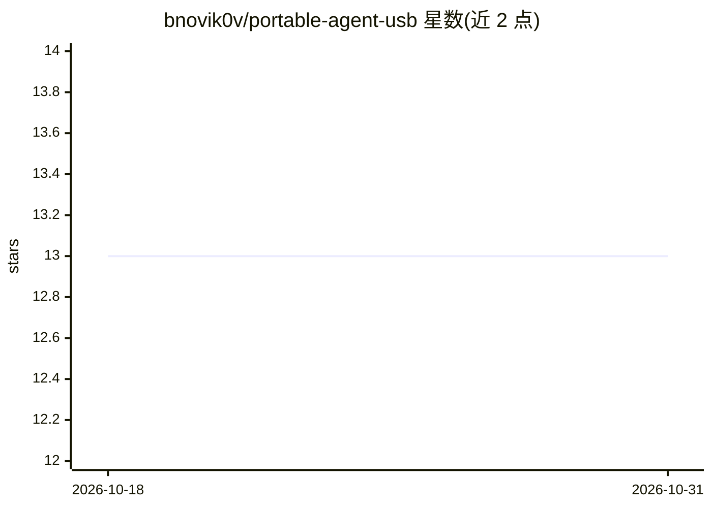

# bnovik0v/portable-agent-usb

⭐ 13 · Shell · MIT · 推送 2026-03-05 · [GitHub](https://github.com/bnovik0v/portable-agent-usb) · 个人维护

**U 盘便携运行 Claude Code 与 Codex 的零安装启动器**

在 USB 驱动器上预置便携版 Node.js 与 Claude Code、Codex CLI，通过启动脚本将 PATH、CLAUDE_CONFIG_DIR、APPDATA、npm 缓存等环境变量全部指向 U 盘，使 AI coding agent 在任意 Windows/Linux x64 主机上即插即用且不留痕迹。认证支持 OAuth（Claude Pro/Max、ChatGPT Plus 订阅）或 API key（key 优先）。构建需在 Linux 上执行 setup.sh，要求 1GB+ U 盘；限制为仅 x64、不支持 ARM 与自动运行。

## 筛选速览

| 维度 | 判定 | 备注 |
|---|---|---|
| AI 角色 | `ai-ecosystem` | LLM/agent 周边工具 |
| 许可风险 | `permissive` | MIT |
| 部署形态 | `None` |  |
| 模型依赖 | — | README 未给出锁定关系 |
| 硬件要求 | — | 无带数字的原话,不猜 |
| 安装摩擦 | `low` | 无编译、无系统依赖或容器化 |
| 成熟度 | — | 结构信号不足 |

## 能力要点

- 便携 Node.js 直接从 U 盘运行，零安装
- PATH/CLAUDE_CONFIG_DIR/APPDATA/npm 缓存等全部重定向至 U 盘，不在主机留文件
- OAuth 与 API key 两种认证方式可共存，token 随 U 盘携带
- Windows 与 Linux x64 双平台启动脚本（start.bat / start.sh）

## 适用场景

- 在他人电脑上临时使用自己的 AI coding agent 且不留痕迹
- 携带个人 CLAUDE.md、技能与配置在多台机器间移动开发
- 不想在本机安装 Node.js 与 agent CLI 的轻量使用方式

## 场景标签

`编码 Agent` · 领域:编码与开发

## 证据(README 行号)

> L3:  Run Claude Code and OpenAI Codex from a USB drive. No installation needed.
> L22: - **Claude Code + Codex CLI** — both agents, ready to use

## 星数曲线

2026-10-18 13 → 2026-10-31 13（+0）

---
*卡片 v1 · prompt 1.4 · 生成 2026-10-31 · 置信度 high · 依据 README sha `db62e71e4843` · [字段定义](../../DATASET.md)*
