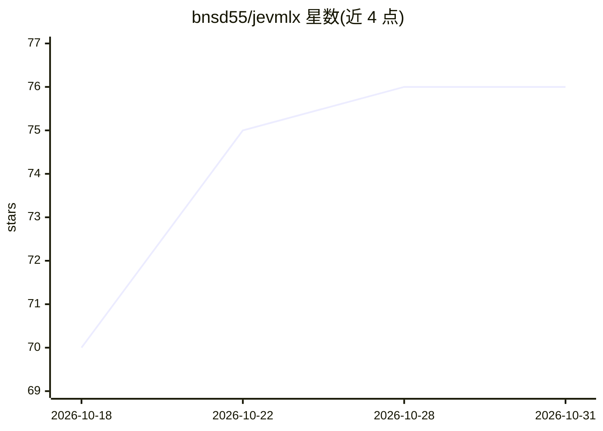

# bnsd55/jevmlx

⭐ 76 · Python · MIT · 推送 2026-10-20 · [GitHub](https://github.com/bnsd55/jevmlx) · [官网](https://github.com/bnsd55/jevmlx#readme) · 个人维护

**Apple Silicon 上的 MLX 并行受限决策库：单次前向产出结构化 JSON**

面向开发者的 Python 库与 CLI：将字段 schema（布尔/枚举/多选）与上下文编译为提示，在本地 MLX 模型上单次 prefill 中对每个字段的全部选项做 logits 打分（restricted softmax），不做文本生成，直接拼装出构造上合法的 JSON，并给出每字段概率与置信边际。支持 ordered 量表、弃权阈值、校准、约束 MAP、批次与 HTTP 服务；亦可经 OpenAI 兼容后端（Ollama/vLLM）调用。需要 Apple Silicon Mac（M1+）与 Python 3.12+；OpenAI 后端模式下每字段一次请求且仅可见 top-k logprobs。

## 筛选速览

| 维度 | 判定 | 备注 |
|---|---|---|
| AI 角色 | `ai-native` | 本体是模型或模型工具 |
| 许可风险 | `permissive` | MIT |
| 部署形态 | `library` | 以包/库形式分发 |
| 模型依赖 | local-ok | 支持本地模型 |
| 硬件要求 | — | 无带数字的原话,不猜 |
| 安装摩擦 | `low` | 无编译、无系统依赖或容器化 |
| 成熟度 | — | 结构信号不足 |

## 能力要点

- 单次前向对全部字段选项打分，无生成、无重试解析
- 每字段输出概率、top3 备选、probability_margin、legal_mass 等遥测
- 内置 support_triage/fintech_fraud 等 6 个预设 schema
- 提供 CLI、Python API、HTTP 服务（背压 429/413）与 TypeScript 客户端

## 适用场景

- 工单分类、内容审核、邮件路由等已知选项集的批量决策
- 在 Mac 上本地跑低成本结构化分类并按概率阈值安排人工复核
- 对比本地 MLX 模型与 API 模型在此类任务上的准确率与成本

## 场景标签

 · 领域:LLM 基础设施/结构化决策

## 证据(README 行号)

> L5: jevmlx turns a schema of fields (booleans, enums, multi-selects) and a context string into a single batched forward 
> L38: Structured output asks the model to write the JSON, token by token, then parses it and retries on failure. When the

## 星数曲线

2026-10-18 70 → 2026-10-31 76（+6）

---
*卡片 v1 · prompt 1.4 · 生成 2026-10-24 · 置信度 mid · 依据 README sha `805aa4022e80` · [字段定义](../../DATASET.md)*
