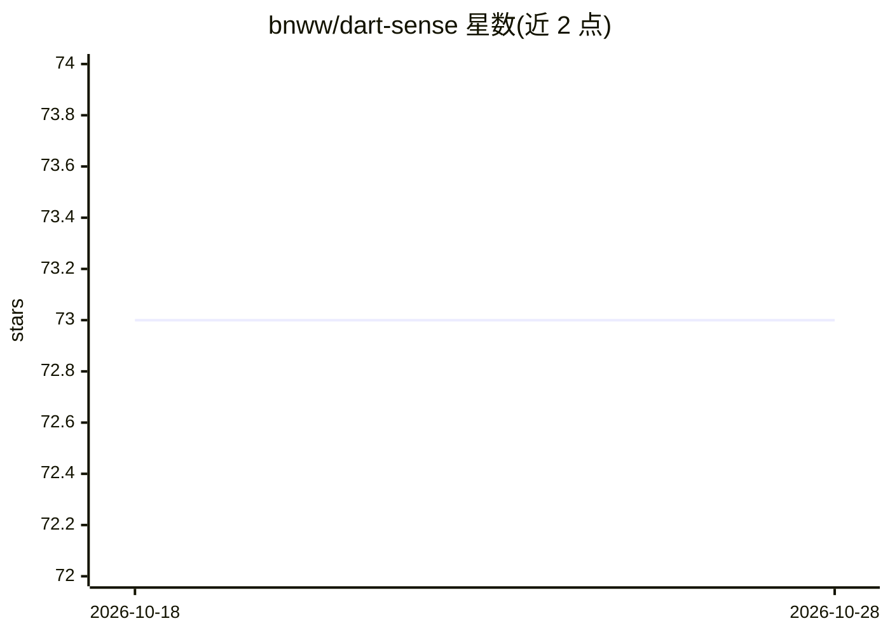

# bnww/dart-sense

⭐ 73 · Python · NOASSERTION · 推送 2026-06-06 · [GitHub](https://github.com/bnww/dart-sense) · 个人维护

**用手机摄像头自动计分飞镖比赛的计算机视觉应用**

基于 YOLOv8n 目标检测的飞镖自动计分应用：检测飞镖落点与 4 个镖盘校准点，将坐标变换到标准镖盘参考平面计算得分，支持任意镖盘与飞镖、任意拍摄角度。通过手机 IP Webcam 流式传输视频实时计分，提供 Tkinter GUI 与 x01、cricket 等游戏规则，可单人至 6 人游玩。源于作者的 AI 硕士论文项目，许可为仅限非商业、不可分发的个人使用。

## 筛选速览

| 维度 | 判定 | 备注 |
|---|---|---|
| AI 角色 | `ai-native` | 本体是模型或模型工具 |
| 许可风险 | `none` | NOASSERTION |
| 部署形态 | `library` | 以包/库形式分发 |
| 模型依赖 | — | README 未给出锁定关系 |
| 硬件要求 | — | 无带数字的原话,不猜 |
| 安装摩擦 | `low` | 无编译、无系统依赖或容器化 |
| 成熟度 | — | 结构信号不足 |

## 能力要点

- YOLOv8n 检测飞镖位置与 4 个校准点，坐标变换后计算得分
- 手机 IP Webcam 视频流实时计分，校准适配任意角度与距离
- 支持 x01、cricket 游戏规则，最多 6 名玩家
- 包含数据标注、训练脚本与精度评估代码（训练数据约 24,000 张图像）

## 适用场景

- 和朋友打飞镖时用手机自动计分，免手动记账
- 实时追踪 x01 或 cricket 比赛比分
- 复用或再训练 YOLO 检测模型做镖盘定位实验

## 场景标签

`目标检测` · 领域:感知与多模态

## 证据(README 行号)

> L7: Dart Sense is an automatic dart scoring application. It uses a sophisticated deep learning-based computer vision mod
> L9: A YOLOv8 object detection model was trained to detect dart positions and board calibration points. By comparing the 

## 星数曲线

2026-10-18 73 → 2026-10-28 73（+0）

---
*卡片 v1 · prompt 1.4 · 生成 2026-10-24 · 置信度 mid · 依据 README sha `3e34a8632555` · [字段定义](../../DATASET.md)*
