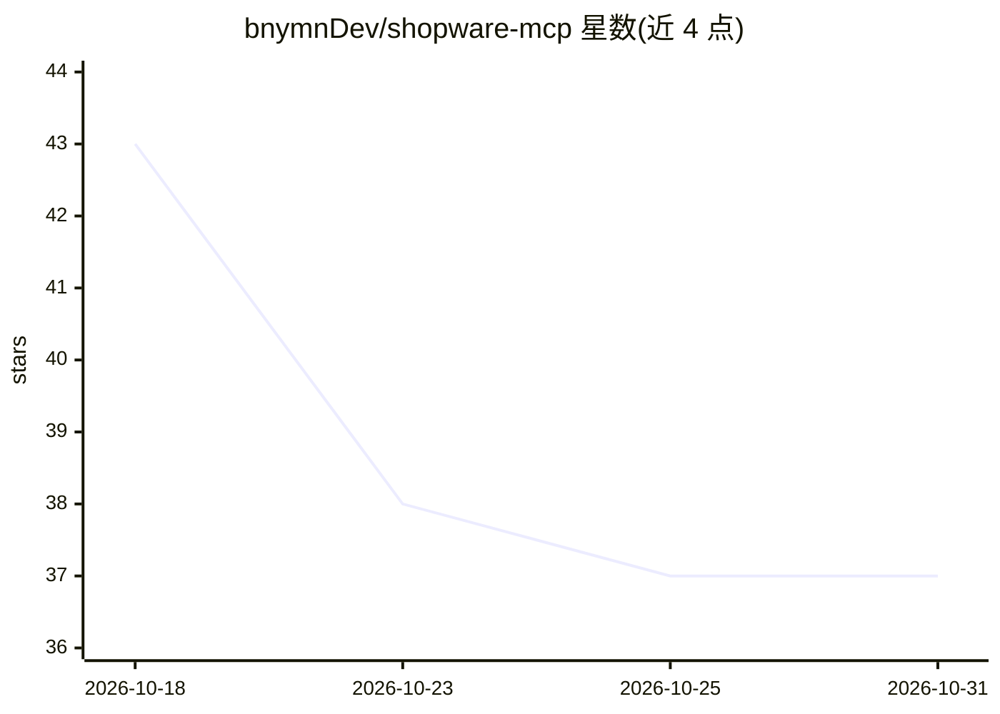

# bnymnDev/shopware-mcp

⭐ 37 · TypeScript · MIT · 推送 2026-10-18 · [GitHub](https://github.com/bnymnDev/shopware-mcp) · [官网](https://www.npmjs.com/package/shopware-mcp) · 个人维护

**面向 Shopware 6 商店的 MCP server：AI 助手运维电商后台**

连接 MCP host 与 Shopware 6 Admin API 的 Node/TypeScript 服务器：提供约 20-27 个精选工具覆盖商品、订单、客户、库存、文档、促销与评论，`shop_audit` 一次调用跑 17 项健康检查，`sales_report`/`stock_forecast` 产出销售报表与补货预测，`checkout_simulate` 经 Store API 以顾客视角试购物并解释失败原因。默认只读，`--allow-write` 下写入先 dry run 且可用预算上限约束；`setup` 命令自动创建最小权限角色与集成。审计与报表也可脱离 MCP host 从 cron/CI 以 CLI 运行。

## 筛选速览

| 维度 | 判定 | 备注 |
|---|---|---|
| AI 角色 | `ai-ecosystem` | LLM/agent 周边工具 |
| 许可风险 | `permissive` | MIT |
| 部署形态 | `self-host` | docker 或自建部署 |
| 模型依赖 | — | README 未给出锁定关系 |
| 硬件要求 | — | 无带数字的原话,不猜 |
| 安装摩擦 | `low` | 无编译、无系统依赖或容器化 |
| 成熟度 | — | 结构信号不足 |

## 能力要点

- 17 项检查的 shop_audit 单次调用健康审计
- 默认只读；写入需 --allow-write 且强制 dry run 预览
- checkout_simulate 以顾客视角通过 Store API 试结算并解释失败原因
- 按已装扩展自动注册附加工具（23→27）

## 适用场景

- 让 Claude/Cursor 等 MCP host 里的助手查询和运营 Shopware 店铺
- 每天一条命令审计店铺健康并生成报表页/Slack 摘要
- 从 cron/CI 无 host 运行 audit 并按严重度设退出码

## 场景标签

 · 领域:电商/Agent 工具

## 证据(README 行号)

> L33: **shopware-mcp is that layer.** One small server that speaks MCP to the host
> L41: |**The customer's view**|`checkout_simulate` puts products and codes into a throwaway cart through Shopware's own S

## 星数曲线

2026-10-18 43 → 2026-10-31 37（-6）

---
*卡片 v1 · prompt 1.4 · 生成 2026-10-25 · 置信度 mid · 依据 README sha `e3fced2a3815` · [字段定义](../../DATASET.md)*
