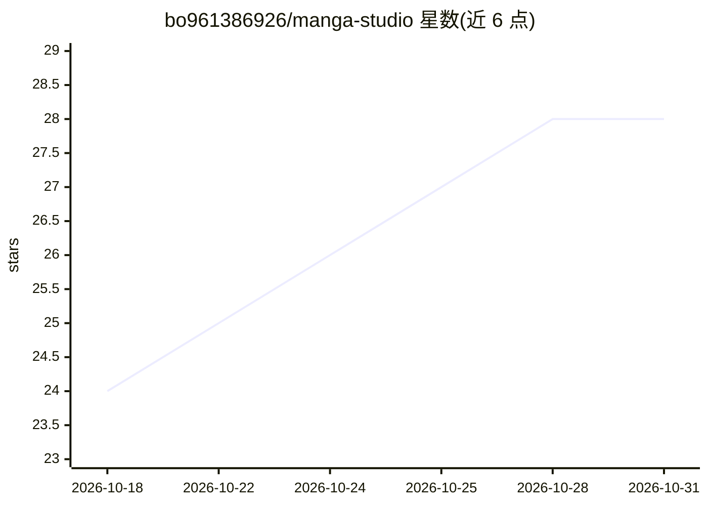

# bo961386926/manga-studio

⭐ 28 · TypeScript · MIT · 推送 2026-10-25 · [GitHub](https://github.com/bo961386926/manga-studio) · 个人维护 · 中文 README

**面向短剧/漫剧创作者的 AI 关键帧驱动视频生成工作台**

面向短剧、漫剧、动态漫画与影视分镜创作者的 AI 生产工作台，采用 Script-to-Asset-to-Keyframe 流程：先用 AI 拆解故事大纲为剧本、角色、场景与分镜，再批量生成角色定妆、服装变体与场景概念图，随后在工作台生成镜头起止关键帧并由视频模型插值生成运动片段，最后统一预览与导出。图像/视频生成参考角色定妆等资产以约束一致性。数据存于浏览器 IndexedDB，通过兼容 OpenAI 风格的 GitCC API 调用模型；提供 Web、Electron 桌面端（Windows 安装包）与 Docker 部署。

## 筛选速览

| 维度 | 判定 | 备注 |
|---|---|---|
| AI 角色 | `ai-native` | 本体是模型或模型工具 |
| 许可风险 | `permissive` | MIT |
| 部署形态 | `self-host` | docker 或自建部署 |
| 模型依赖 | — | README 未给出锁定关系 |
| 硬件要求 | — | 无带数字的原话,不猜 |
| 安装摩擦 | `low` | 无编译、无系统依赖或容器化 |
| 成熟度 | — | 结构信号不足 |

## 能力要点

- 剧本大纲一键拆解为剧本结构、角色、场景与分镜
- 关键帧驱动：先画起止帧，视频模型插值生成运动
- 角色定妆/服装变体/场景概念图作为生成参考资产
- Web / Electron 桌面端 / Docker 多端交付

## 适用场景

- 把故事或小说创意快速转为可预览的分镜与视频片段
- 为短剧/漫剧项目沉淀角色定妆与场景视觉资产
- 按关键帧批量生成 AI 视频片段并导出到后期剪辑

## 场景标签

`视频生成` `图像生成` · 领域:内容生成

## 证据(README 行号)

> L15: **漫剧工场** 是一个面向短剧、漫剧、动态漫画与影视分镜创作者的 AI 生产工作台，目标是把故事创意快速转化为可预览、可导出、可继续剪辑的视觉资产与视频片段。
> L133: - **文本模型**：用于剧本拆解、角色/场景分析、提示词改写和视频描述生成。
> L135: - **视频模型**：用于根据提示词、起始帧或起止关键帧生成视频片段。

## 星数曲线

2026-10-18 24 → 2026-10-31 28（+4）

---
*卡片 v1 · prompt 1.4 · 生成 2026-10-26 · 置信度 high · 依据 README sha `571ca14b7e9a` · [字段定义](../../DATASET.md)*
