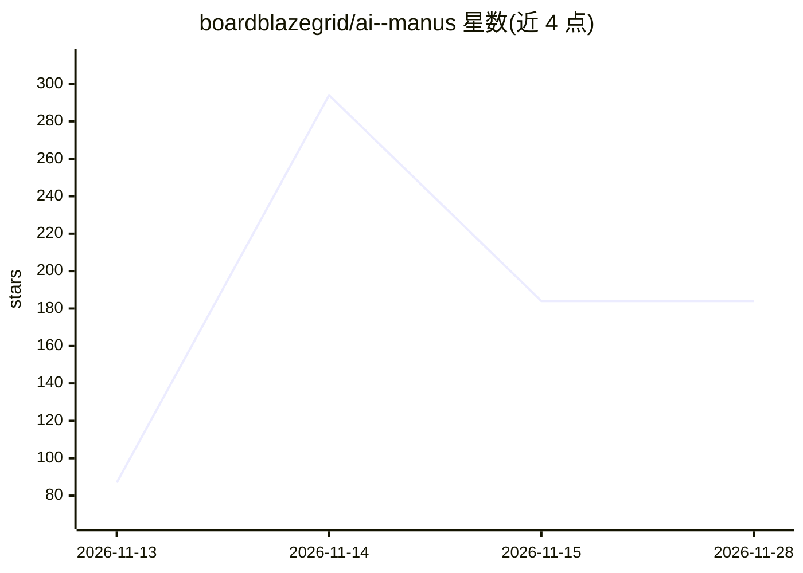

# boardblazegrid/ai--manus

⭐ 184 · Apache-2.0 · 推送 2026-11-15 · [GitHub](https://github.com/boardblazegrid/ai--manus) · 个人维护

**面向日常任务的自主 AI Agent：代替用户运行代码与控制浏览器**

自称 Manus 的自主 AI Agent 系统，描述称其可在沙盒环境中运行各类工具与操作。README 宣称的能力包括：自主编写并执行脚本、控制浏览器（导航网页、填表、采集信息）、执行多步骤日常任务，供学生、远程工作者等非开发者用于研究整理、信息收集与轻量办公。文档给出兼容性要求（64 位系统、双核 CPU、4GB 内存起步）与上手步骤。注意：README 未提供任何安装命令、源码入口或技术实现细节，且带有下载推广码，可信度存疑。

## 筛选速览

| 维度 | 判定 | 备注 |
|---|---|---|
| AI 角色 | `ai-native` | 本体是模型或模型工具 |
| 许可风险 | `permissive` | Apache-2.0 |
| 部署形态 | `None` |  |
| 模型依赖 | — | README 未给出锁定关系 |
| 硬件要求 | — | 无带数字的原话,不猜 |
| 安装摩擦 | `low` | 无编译、无系统依赖或容器化 |
| 成熟度 | — | 结构信号不足 |

## 能力要点

- 宣称自主代码执行与浏览器控制
- 宣称跨脚本与浏览器的多步骤任务编排
- 兼容性要求：双核 CPU / 4GB 内存起步（推荐 8GB）

## 适用场景

- 让学生整理研究笔记并运行小脚本
- 从多个网页收集信息并汇总
- 把重复性的小型日常任务委托给后台 agent

## 场景标签

`浏览器自动化` · 领域:效率与自动化

## 证据(README 行号)

> L10: - **Autonomous Code Execution:** Manus AI agent runs code on its own to complete tasks, so you can focus on decisio
> L18: Manus is an autonomous AI agent designed to run code and control a browser on your behalf. Instead of acting like a

## 星数曲线

2026-11-13 87 → 2026-11-28 184（+97）

---
*卡片 v1 · prompt 1.4 · 生成 2026-11-17 · 置信度 low · 依据 README sha `0f78ee3a5dd2` · [字段定义](../../DATASET.md)*
