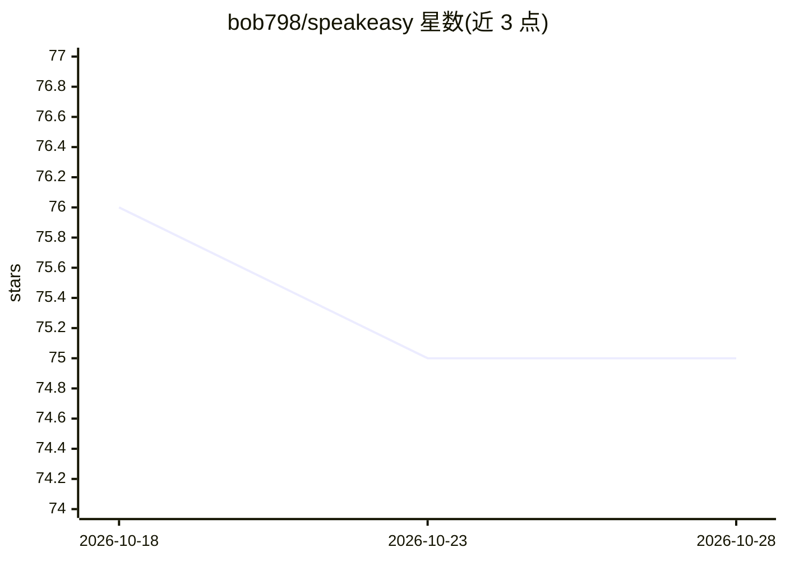

# bob798/speakeasy

⭐ 75 · Python · NOASSERTION · 推送 2026-09-29 · [GitHub](https://github.com/bob798/speakeasy) · 个人维护 · 中文 README

**给英语学习者的 AI 陪伴式私教，越聊越懂你**

基于 FastAPI 的英语口语练习应用：用户与 AI 角色 Alex 用英语聊真实生活话题，系统持续积累用户画像（职业、语法习惯、生活事件）与跨会话记忆，在对话中隐式植入需强化的表达，并在对话后生成复盘。功能含语音输入输出、FSRS 复习调度、B站字幕提取的文章学习、生词本、双向翻译、JWT 账号系统。支持 Claude、DeepSeek、火山方舟、智谱 GLM 等多模型 API Key，可本地 uvicorn 运行或 Docker 部署到 VPS。

## 筛选速览

| 维度 | 判定 | 备注 |
|---|---|---|
| AI 角色 | `ai-native` | 本体是模型或模型工具 |
| 许可风险 | `none` | NOASSERTION |
| 部署形态 | `self-host` | docker 或自建部署 |
| 模型依赖 | locked-api |  |
| 硬件要求 | — | 无带数字的原话,不猜 |
| 安装摩擦 | `low` | 无编译、无系统依赖或容器化 |
| 成熟度 | — | 结构信号不足 |

## 能力要点

- 跨会话用户画像与事实记忆，对话内容持续积累
- 隐式强化 + 显式复盘（错误分析/亮点）双路径
- FSRS 错误调度与复习闭环、生词本
- 多模型支持（Anthropic/DeepSeek/火山方舟/智谱）与 Docker/VPS 部署流程

## 适用场景

- 想练英语口语但需要了解我的对话对象
- 对话后回顾哪里说得地道、哪里可改进
- 通过文章学习与 FSRS 复习巩固词汇表达

## 场景标签

`聊天机器人` · 领域:对话与助手

## 证据(README 行号)

> L21: 你们聊你真实生活里的事——今天的会议、遇到的麻烦、周末去了哪里。Alex 持续积累对你的认知：你是做什么的、你哪里容易出错、你上周发生了什么。每次对话，Alex 比上次更懂你——话题更贴合你，引导更精准，强化的点更有针对性。
> L26: 对话过程中，Alex 自然地在回复里植入你需要强化的表达。你以为在聊天，Alex 知道你在进步。
> L77: |V0.2b ✅|对话复盘（错误分析 + 亮点）+ FSRS 错误调度 + 点击追问 UI|

## 星数曲线

2026-10-18 76 → 2026-10-28 75（-1）

---
*卡片 v1 · prompt 1.4 · 生成 2026-10-24 · 置信度 high · 依据 README sha `ea4f17b4e767` · [字段定义](../../DATASET.md)*
