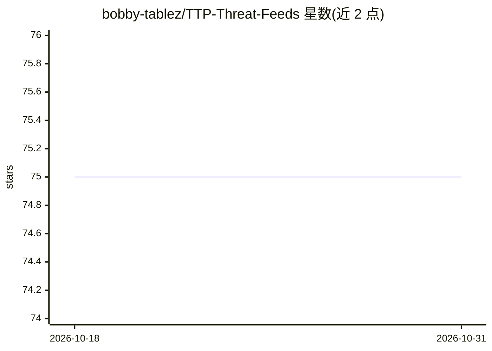

# bobby-tablez/TTP-Threat-Feeds

⭐ 75 · Python · MIT · 推送 2026-06-17 · [GitHub](https://github.com/bobby-tablez/TTP-Threat-Feeds) · 个人维护

**AI 驱动的威胁情报源生成器：从安全研究文章提取 TTP 与 IOC**

Python 脚本工具，面向检测工程师与威胁研究人员：抓取 urls.txt 中可信厂商博客的文章（含截图 OCR），送入 LLM 提取摘要、归属、恶意软件家族、MITRE ATT&CK 技术、命令行、进程关系、持久化/横移痕迹与 IOC（域名/IP/哈希/URL），输出按日期和来源组织的结构化 YAML 文件。支持本地（LM Studio/Ollama）与云端（OpenAI/Claude/Gemini）多种 LLM 供应方；README 声明结果由 LLM 生成可能有误，不建议接入自动化管道。

## 筛选速览

| 维度 | 判定 | 备注 |
|---|---|---|
| AI 角色 | `ai-native` | 本体是模型或模型工具 |
| 许可风险 | `permissive` | MIT |
| 部署形态 | `library` | 以包/库形式分发 |
| 模型依赖 | local-ok | 支持本地模型 |
| 硬件要求 | — | 无带数字的原话,不猜 |
| 安装摩擦 | `low` | 无编译、无系统依赖或容器化 |
| 成熟度 | — | 结构信号不足 |

## 能力要点

- 抓取可信威胁情报源并经 LLM 提取 TTP/IOC，输出结构化 YAML
- 支持 LM Studio/Ollama 本地与 OpenAI/Claude/Gemini 云端供应方
- pytesseract OCR 提取截图中的命令行与 TTP 内容
- 结果按日期/来源存储，附带时间戳与来源域名

## 适用场景

- 批量从威胁研究报告提取 ATT&CK 技术与 IOC 用于检测工程
- 定期跟踪可信厂商博客并生成结构化情报源
- 离线（本地 LLM）处理敏感威胁研究材料

## 场景标签

`网络安全` `OCR` · 领域:学习与行业

## 证据(README 行号)

> L3: **TTP-Threat-Feeds** is a script-powered threat feed generator designed to extract adversarial TTPs and IOCs using ✨
> L13: - Feeds content into a local LLM with a purpose-built prompt

## 星数曲线

2026-10-18 75 → 2026-10-31 75（+0）

---
*卡片 v1 · prompt 1.4 · 生成 2026-10-24 · 置信度 mid · 依据 README sha `97b039227f82` · [字段定义](../../DATASET.md)*
