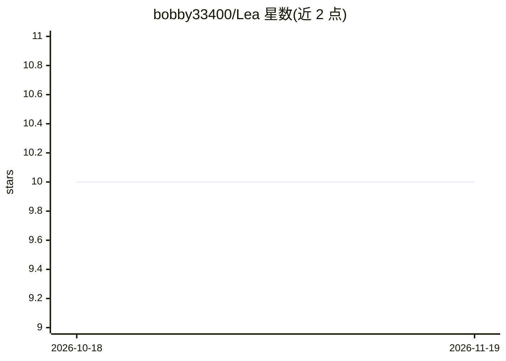

# bobby33400/Lea

⭐ — · [GitHub]() · 个人维护

**为开发者排队并自动运行 Claude Code/Codex 编码任务**

跨平台桌面应用（Electron）：用户将任务（指令+项目文件夹）排入队列，Lea 以 headless 方式调用 Claude Code（claude -p）或 Codex（codex exec）自动执行；通过读取本地 jsonl 记录（经 ccusage）跟踪 Claude 用量，在额度窗口重置时刻自动重试排队任务。每次运行默认隔离：macOS 用 Seatbelt 沙箱，Windows/Linux 可选 Docker。需用户自行安装并登录 agent CLI，安装包未签名。

## 筛选速览

| 维度 | 判定 | 备注 |
|---|---|---|
| AI 角色 | `ai-ecosystem` | LLM/agent 周边工具 |
| 许可风险 | `permissive` | — |
| 部署形态 | `desktop` | 安装包/桌面程序 |
| 模型依赖 | — | README 未给出锁定关系 |
| 硬件要求 | — | 无带数字的原话,不猜 |
| 安装摩擦 | `low` | 无编译、无系统依赖或容器化 |
| 成熟度 | — | 结构信号不足 |

## 能力要点

- 任务队列配合额度重置时钟自动运行 headless 编码 agent
- 支持 Claude Code 与 Codex 双 agent，可按任务选择并指定模型
- 运行隔离：macOS Seatbelt 沙箱、Docker 容器后端可选
- 读取 ccusage 显示 token 用量、成本与重置倒计时

## 适用场景

- 睡前排队编码任务，额度重置后自动在夜间完成
- 管理 Claude Code 用量并在窗口重置时自动续跑
- 在沙箱隔离下无人值守运行 agent 任务并查看日志

## 场景标签

`编码 Agent` · 领域:编码与开发

## 证据(README 行号)

> L5: Lea is a cross-platform app that runs a **to-do queue automatically** using the
> L43: - **Runs them autonomously** with headless `claude -p` or `codex exec`. If a run
> L98: - **macOS, Windows, or Linux**, Node 18+.

## 星数曲线

2026-10-18 10 → 2026-11-19 10（+0）

---
*卡片 v1 · prompt 1.4 · 生成 2026-11-19 · 置信度 high · 依据 README sha `4b7613376e2d` · [字段定义](../../DATASET.md)*
