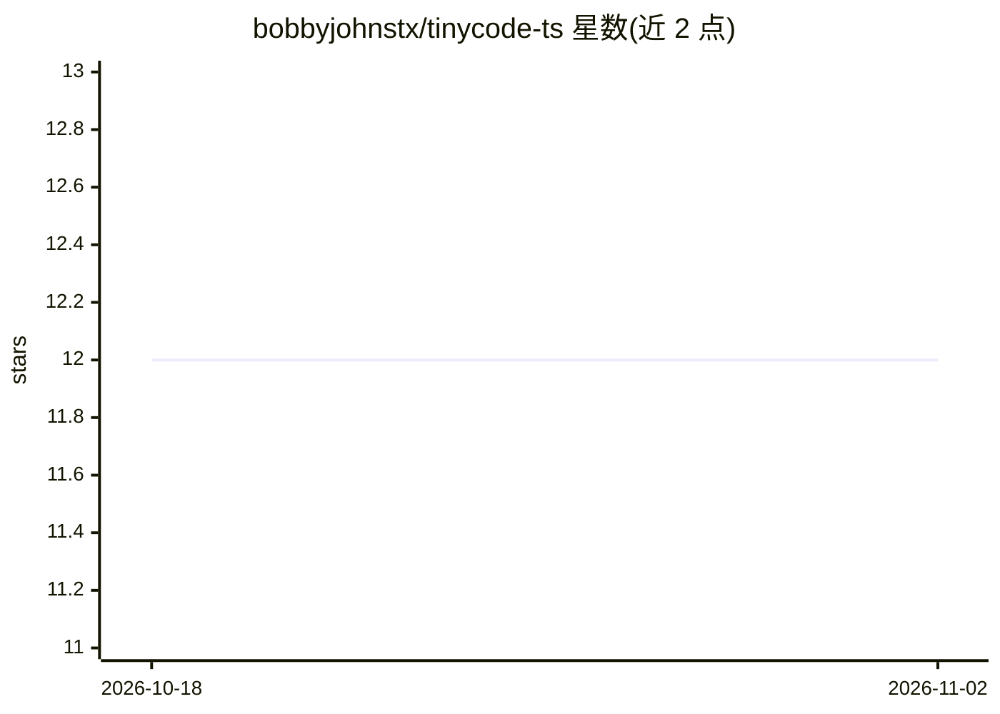

# bobbyjohnstx/tinycode-ts

⭐ 12 · TypeScript · MIT · 推送 2026-10-30 · [GitHub](https://github.com/bobbyjohnstx/tinycode-ts) · [官网](https://github.com/bobbyjohnstx/tinycode#readme) · 个人维护

**本地 LLM 优先的 AI 编程助手：TUI/Web/桌面端，代码不出本机**

开源 AI 编程助手，定位与 Claude Code/Codex 同类：读文件、跑命令、编辑代码、多步任务执行，但默认对接用户自有模型（Ollama、vLLM 或任意 OpenAI 兼容端点），可离线运行，无云账号与遥测。提供 TUI（主界面）、SolidJS Web UI 与 Electron 桌面应用三种形态，支持 ACP 协议接入 VS Code/Zed/JetBrains。内置 build/plan 双模式（plan 为工具层强制只读）、约 26 个内置 agent 角色、9 个技能命令与 oh-my-tiny 插件。云端厂商（Anthropic/OpenAI/Google/OpenRouter）为可选接入。

## 筛选速览

| 维度 | 判定 | 备注 |
|---|---|---|
| AI 角色 | `ai-native` | 本体是模型或模型工具 |
| 许可风险 | `permissive` | MIT |
| 部署形态 | `library` | 以包/库形式分发 |
| 模型依赖 | local-ok | 支持本地模型 |
| 硬件要求 | — | 无带数字的原话,不猜 |
| 安装摩擦 | `low` | 无编译、无系统依赖或容器化 |
| 成熟度 | — | 结构信号不足 |

## 能力要点

- TUI/Web UI/Electron 桌面三形态，支持 ACP 协议接入 IDE
- 默认对接本地 Ollama/vLLM/OpenAI 兼容端点，可断网运行
- plan 模式在工具层强制只读，plan_exit 审批后切换执行
- 内置 26 个 agent 角色与 oh-my-tiny 编排插件，≤8B 模型自动使用紧凑提示

## 适用场景

- 在本地或内网模型上跑 AI 编程助手，代码不外发
- 通过 ACP 协议在 VS Code/Zed/JetBrains 中使用
- 用 plan 模式先做只读规划再审批执行的多步任务

## 场景标签

`编码 Agent` · 领域:编码与开发

## 证据(README 行号)

> L11: tinycode fills the gap between cloud-only AI coding tools and privacy. It's the same kind of tool as Claude Code or
> L7: An open-source AI coding assistant that keeps your code on your machine. No cloud accounts, no API keys, no data lea

## 星数曲线

2026-10-18 12 → 2026-11-02 12（+0）

---
*卡片 v1 · prompt 1.4 · 生成 2026-11-01 · 置信度 high · 依据 README sha `a04643090812` · [字段定义](../../DATASET.md)*
