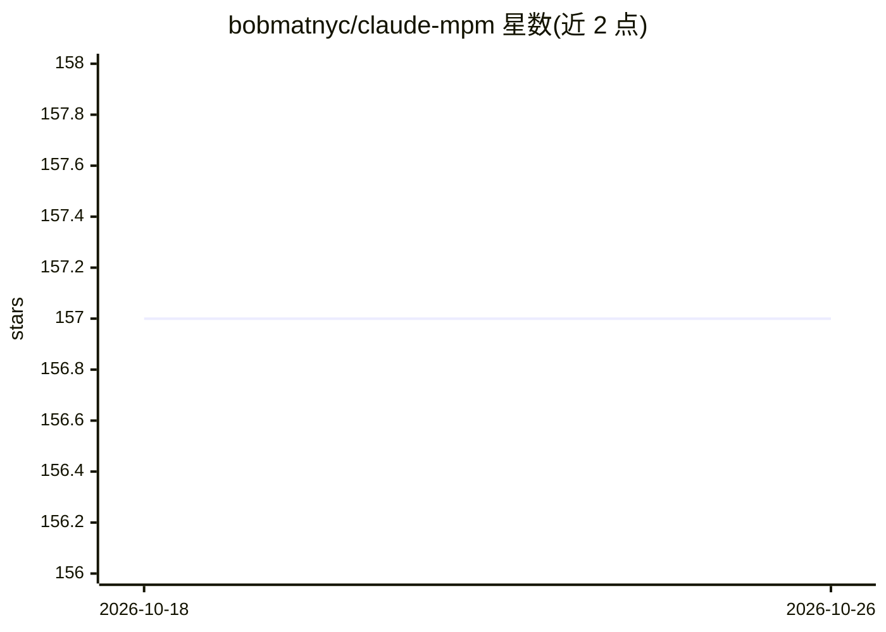

# bobmatnyc/claude-mpm

⭐ 157 · Python · NOASSERTION · 推送 2026-08-31 · [GitHub](https://github.com/bobmatnyc/claude-mpm) · 个人维护

**Claude Code 的多智能体项目管理工作流框架**

面向 Claude Code CLI 的工作流与智能体管理框架：将 AI 编码助手扩展为开发平台，提供 47+ 专业智能体与 PM 编排路由、56+ 内置技能的三级组织体系、MCP 集成（Google Workspace/Notion/Confluence/Slack）、会话恢复与实时监控仪表盘。需要 Claude Code CLI v1.0.92+（Skills 需 v2.1.3+），Python 3.11-3.13（3.14 不支持）。支持插件方式安装或 pip/uv 完整安装，服务非技术用户、开发者与团队。

## 筛选速览

| 维度 | 判定 | 备注 |
|---|---|---|
| AI 角色 | `ai-ecosystem` | LLM/agent 周边工具 |
| 许可风险 | `none` | NOASSERTION |
| 部署形态 | `library` | 以包/库形式分发 |
| 模型依赖 | locked-api |  |
| 硬件要求 | — | 无带数字的原话,不猜 |
| 安装摩擦 | `low` | 无编译、无系统依赖或容器化 |
| 成熟度 | — | 结构信号不足 |

## 能力要点

- 47+ 专业智能体与 PM 智能编排路由
- 56+ 内置技能，三级优先级解析与按需加载
- MCP 集成覆盖 Google Workspace（67 工具）、Notion、Confluence、Slack
- 会话恢复、70%/85%/95% 阈值自动摘要、实时监控仪表盘
- ZTK Shell 输出压缩，宣称 80-97% token 缩减

## 适用场景

- 用多智能体协作完成 Python/TypeScript/Rust 等开发任务
- 非技术用户通过 Research Mode 理解代码库
- 将 Claude Code 接入 Notion、Slack、Google Workspace 等服务
- 按模型层级为每个智能体指定 claude 模型

## 场景标签

`多智能体` `编码 Agent` · 领域:Agent 开发

## 证据(README 行号)

> L8: **A comprehensive workflow and agent management framework for Claude Code** that transforms your AI coding assistant
> L57: ### 🤖 Multi-Agent System
> L69: ### 🔌 MCP Integration (Model Context Protocol)

## 星数曲线

2026-10-18 157 → 2026-10-26 157（+0）

---
*卡片 v1 · prompt 1.4 · 生成 2026-10-22 · 置信度 high · 依据 README sha `172f0599bd0e` · [字段定义](../../DATASET.md)*
