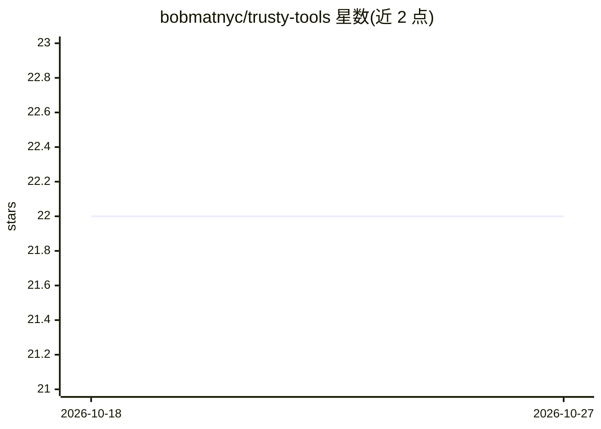

# bobmatnyc/trusty-tools

⭐ 22 · Rust · MIT · 推送 2026-10-26 · [GitHub](https://github.com/bobmatnyc/trusty-tools) · [官网](https://trustytools.dev) · 个人维护

**Rust 编写的 AI 开发者工具集：代码搜索、记忆、分析、PR 审查与多 agent 编排**

统一 Cargo workspace 聚合 trusty-* 系列开发工具：trusty-search 提供机器级 BM25+向量+知识图谱混合代码搜索（MCP server）；trusty-memory 提供带语义检索与嵌入 UI 的长期记忆存储；trusty-analyze 提供复杂度、代码异味与质量评分的静态分析 sidecar；trusty-review 经 AWS Bedrock 或 OpenRouter 调用 LLM 审查 GitHub PR；trusty-mpm 编排 Claude Code 多 agent 会话。各组件以 MCP server/守护进程/CLI 形式运行，通过 curl 一键安装脚本或 cargo 安装，支持 macOS Apple Silicon 与 Linux x86_64/arm64。

## 筛选速览

| 维度 | 判定 | 备注 |
|---|---|---|
| AI 角色 | `ai-ecosystem` | LLM/agent 周边工具 |
| 许可风险 | `permissive` | MIT |
| 部署形态 | `library` | 以包/库形式分发 |
| 模型依赖 | locked-api |  |
| 硬件要求 | — | 无带数字的原话,不猜 |
| 安装摩擦 | `low` | 无编译、无系统依赖或容器化 |
| 成熟度 | — | 结构信号不足 |

## 能力要点

- BM25 + 向量 + 知识图谱融合的混合代码搜索（RRF 融合，分支感知）
- 纯 Rust HNSW 向量索引 + fastembed 嵌入的长期记忆存储引擎
- LLM 驱动的 GitHub PR 审查（Bedrock/OpenRouter），默认 dry-run
- 面向 Claude Code 会话的多 agent 编排平台（TUI 面板与 Telegram bot）

## 适用场景

- 为本机多个项目建代码索引并用自然语言或 MCP 工具检索
- 让 AI 编程会话通过 MCP 读写长期记忆与代码上下文
- 自动拉取 GitHub PR diff 并生成结构化 LLM 审查结论

## 场景标签

`Agent 记忆` `多智能体` `编码 Agent` `语义搜索` · 领域:Agent 开发

## 证据(README 行号)

> L23: PM-style multi-agent orchestration over coding work: manages multi-project
> L93: Fast local PR-review service: LLM-backed code review with search and analysis
> L68: Machine-wide code search daemon with hybrid BM25 + vector + knowledge-graph fusion, fused via Reciprocal Rank Fusio

## 星数曲线

2026-10-18 22 → 2026-10-27 22（+0）

---
*卡片 v1 · prompt 1.4 · 生成 2026-10-27 · 置信度 high · 依据 README sha `2b517461ba84` · [字段定义](../../DATASET.md)*
