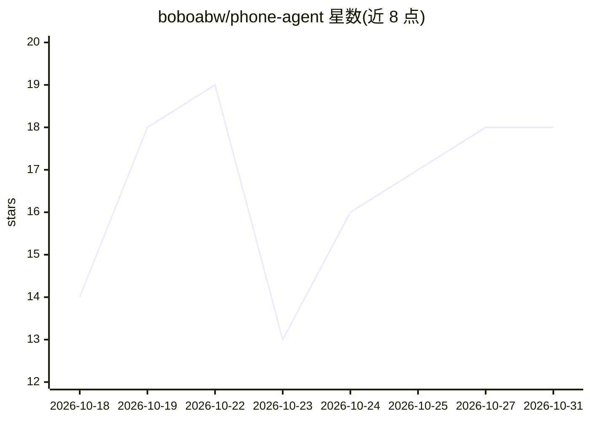

# boboabw/phone-agent

⭐ 18 · Swift · 推送 2026-10-06 · [GitHub](https://github.com/boboabw/phone-agent) · 个人维护 · 中文 README

**通过屏幕理解与 ESP32-S3 蓝牙外设操作 iPhone 的原生 AI 助手**

SwiftUI 编写的 iPhone 原生 AI 助手：读取用户共享的屏幕图像，经视觉模型生成动作，再通过 ESP32-S3 蓝牙鼠标/键盘外设在手机上执行点击、移动与输入，实现观察-执行-再观察的自动化循环。附带对话、语音、文件与工具、Siri/快捷指令等系统能力。需要 iOS 27 设备、ESP32-S3 开发板、Xcode 27 自行构建以及自带 API key 的图像模型端点；GPIO48 RGB LED 指示连接与任务状态。

## 筛选速览

| 维度 | 判定 | 备注 |
|---|---|---|
| AI 角色 | `ai-native` | 本体是模型或模型工具 |
| 许可风险 | `none` | — |
| 部署形态 | `None` |  |
| 模型依赖 | — | README 未给出锁定关系 |
| 硬件要求 | — | 无带数字的原话,不猜 |
| 安装摩擦 | `low` | 无编译、无系统依赖或容器化 |
| 成熟度 | — | 结构信号不足 |

## 能力要点

- 屏幕理解 + 蓝牙 HID 外设的视觉自动化控制循环
- 任务队列、暂停/停止、人工接管与执行中追加指令
- BLE 外设支持鼠标输入、ASCII 键盘与 21 步指针校准
- GPIO48 WS2812 RGB LED 显示连接与任务状态

## 适用场景

- 用自然语言让 AI 代替自己在 iPhone 上完成点单等操作
- 视障或操作不便用户通过语音/对话驱动手机操作
- 结合 Siri 与快捷指令触发自动化手机任务

## 场景标签

`GUI 自动化` · 领域:效率与自动化

## 证据(README 行号)

> L5: **An AI assistant that sees your screen and operates your iPhone**
> L18: Phone Agent is a native iPhone AI assistant. It understands the screen you choose to share, then uses an ESP32-S3 B

## 星数曲线

2026-10-18 14 → 2026-10-31 18（+4）

---
*卡片 v1 · prompt 1.4 · 生成 2026-10-29 · 置信度 high · 依据 README sha `6cd3a163883d` · [字段定义](../../DATASET.md)*
