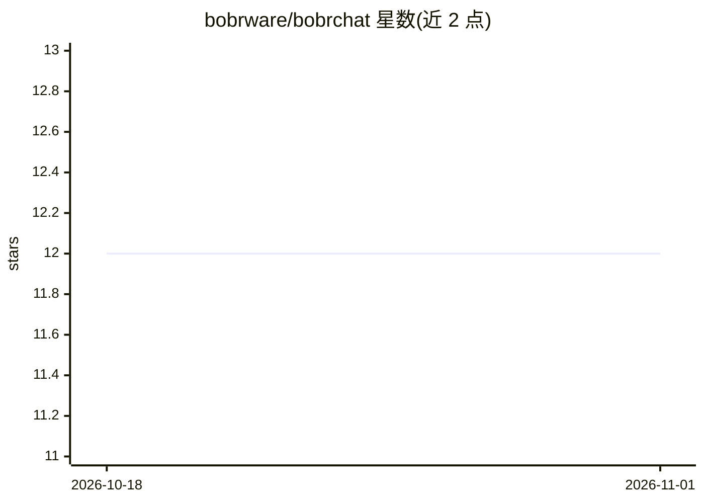

# bobrware/bobrchat

⭐ 12 · TypeScript · NOASSERTION · 推送 2026-10-11 · [GitHub](https://github.com/bobrware/bobrchat) · [官网](https://bobrchat.com) · 组织维护

**按 token 付费的多模型 AI 聊天界面，支持 200+ 模型**

基于 Next.js 16 与 Vercel AI SDK + OpenRouter 构建的 Web 聊天界面，可切换 Claude、GPT、Llama 等 200+ 模型，提供逐条消息的实时成本显示、API key 本地或加密云端存储、文件上传与并行网络搜索、可分享会话。用户自带 API key 时无平台加价，另有 $2.99/月 Plus 档提供无限会话与 100MB 存储。开发使用 Nix 工具链与 Bun 运行时，部署到 Cloudflare Workers；许可证为 BSL 1.1（2027 年 1 月转为 MIT）。

## 筛选速览

| 维度 | 判定 | 备注 |
|---|---|---|
| AI 角色 | `ai-native` | 本体是模型或模型工具 |
| 许可风险 | `none` | NOASSERTION |
| 部署形态 | `None` |  |
| 模型依赖 | — | README 未给出锁定关系 |
| 硬件要求 | — | 无带数字的原话,不猜 |
| 安装摩擦 | `low` | 无编译、无系统依赖或容器化 |
| 成熟度 | — | 结构信号不足 |

## 能力要点

- 通过 OpenRouter 接入 200+ 模型并即时切换
- 逐条消息的实时成本拆解
- API key 本地存储或加密云端存储（BYOK）
- 文件附件与并行网络搜索

## 适用场景

- 在一个界面里对比不同模型的回复与成本
- 自带 API key 按 token 付费使用多种模型
- 上传文件、联网搜索并获得可分享的会话

## 场景标签

`聊天机器人` · 领域:对话与助手

## 证据(README 行号)

> L5:  Pay only for what you use. Chat with Claude, GPT-5, Llama, and 200+ models
> L60: |**AI**|Vercel AI SDK + OpenRouter|

## 星数曲线

2026-10-18 12 → 2026-11-01 12（+0）

---
*卡片 v1 · prompt 1.4 · 生成 2026-11-01 · 置信度 high · 依据 README sha `f94d2458fdb2` · [字段定义](../../DATASET.md)*
