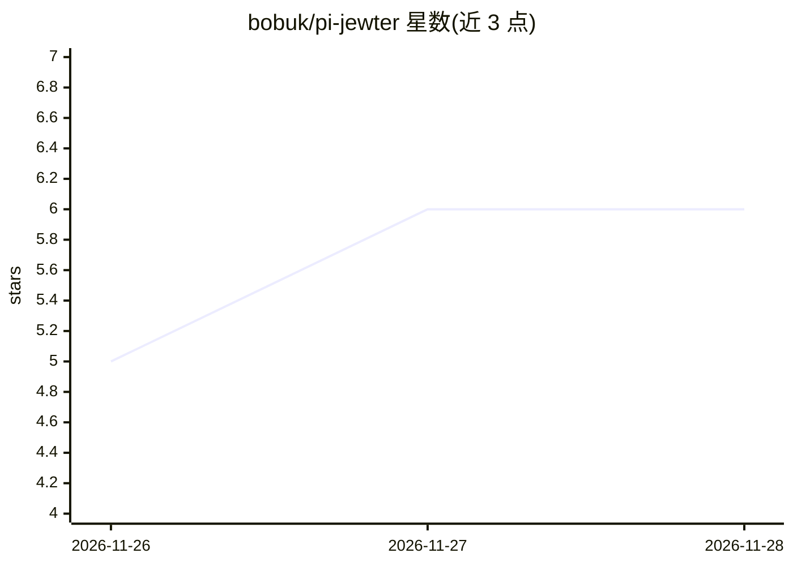

# bobuk/pi-jewter

⭐ 6 · TypeScript · MIT · 推送 2026-11-24 · [GitHub](https://github.com/bobuk/pi-jewter) · [官网](https://www.npmjs.com/package/pi-jewter) · 个人维护

**Pi 编码代理的模型路由扩展：按任务与角色自动选模型**

Jewter 是 Pi 编码代理的扩展插件，在会话推进时用 Jev 分类器识别任务类型与所需模型能力，从用户配置的模型池中按 fast/medium/strong 三档能力分层选择模型与思考级别，使规划、实现、审查、验证各环节可使用不同模型组合。内置缓存切换惩罚以减少边际模型变更，提供 /jewter 系列命令查看路由决策与预览路由。依赖 Pi 1.5.0+、Node 22.19.0+，且 Jev 分类需 TypeSafe 或 OpenRouter 的 API key。

## 筛选速览

| 维度 | 判定 | 备注 |
|---|---|---|
| AI 角色 | `ai-ecosystem` | LLM/agent 周边工具 |
| 许可风险 | `permissive` | MIT |
| 部署形态 | `None` |  |
| 模型依赖 | locked-api |  |
| 硬件要求 | — | 无带数字的原话,不猜 |
| 安装摩擦 | `low` | 无编译、无系统依赖或容器化 |
| 成熟度 | — | 结构信号不足 |

## 能力要点

- 基于 Jev 分类器在每步代理动作前做任务识别与模型选择
- fast/medium/strong 能力分层配置，角色（规划/实现/审查）可覆盖默认路由
- 路由决策可查看（/jewter status/why）并可随时切回指定模型绕过路由
- 可选上下文压缩与验证建议（验证建议不自动发送请求）

## 适用场景

- 让简单问题自动使用低成本模型、复杂调试使用高能力模型
- 在同一个编码会话中为规划、实现、审查分配不同模型
- 查看每次回答实际由哪个模型生成并手动接管切换

## 场景标签

`模型网关` · 领域:Agent 开发

## 证据(README 行号)

> L5: 🎯 **Use the right model for each task without switching models by hand.** Small questions rarely need your most expe
> L7: 🔀 **Select `jewter/auto` once.** By default, before each agent step (including after tool results), Jewter uses the 
> L15: Requires **Pi 1.5.0+**, **Node 22.19.0+**, a **TypeSafe or OpenRouter API key for Jev**, and at least one model you

## 星数曲线

2026-11-26 5 → 2026-11-28 6（+1）

---
*卡片 v1 · prompt 1.4 · 生成 2026-11-26 · 置信度 high · 依据 README sha `6dc5f159bb57` · [字段定义](../../DATASET.md)*
