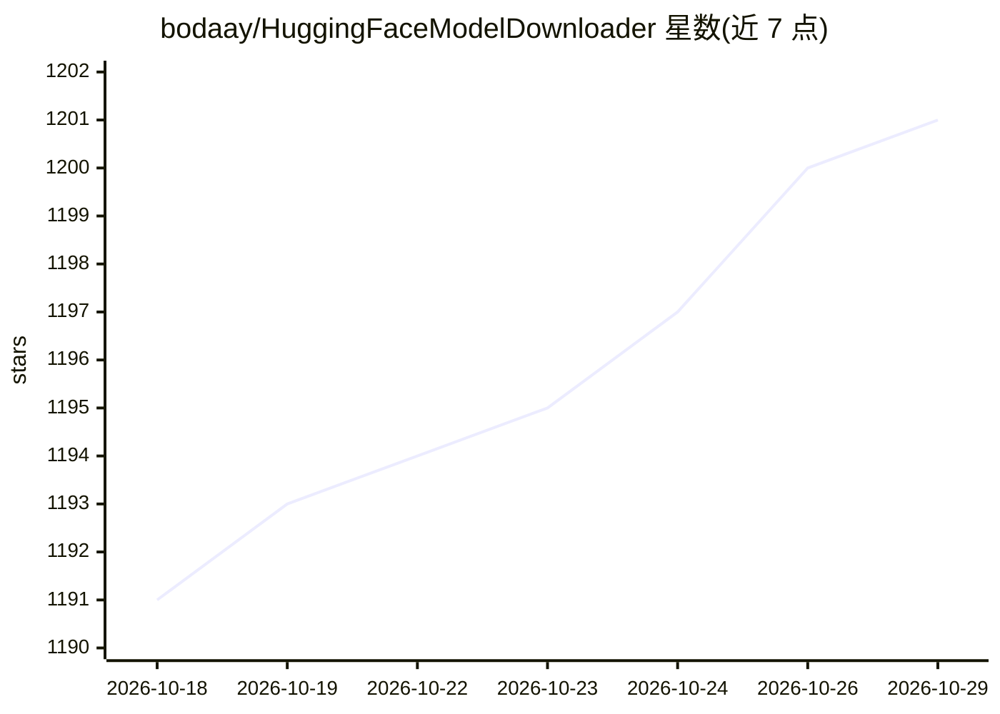

# bodaay/HuggingFaceModelDownloader

⭐ 1,201 · Go · Apache-2.0 · 推送 2026-10-04 · [GitHub](https://github.com/bodaay/HuggingFaceModelDownloader) · 个人维护 · 中文 README

**Go 编写的 HuggingFace 模型与数据集并行下载工具**

面向需要从 HuggingFace Hub 获取模型/数据集的用户，提供单文件多连接（最多 16）与多文件并发的下载、断点续传与校验；内置 GGUF 分析器（交互式量化选择、质量评级、RAM 估算），自动识别 Transformers/Diffusers/LoRA/GPTQ 等仓库类型。存储兼容 HF 标准缓存（Python 库可直接读取），也可导出/直接下载为普通文件供 LM Studio、Ollama、llama.cpp 使用。附带 Web UI、多机镜像同步、SOCKS5/HTTP 代理与 hf-mirror.com 镜像端点支持。以二进制、一键脚本、源码构建与 Docker 镜像分发。

## 筛选速览

| 维度 | 判定 | 备注 |
|---|---|---|
| AI 角色 | `ai-ecosystem` | LLM/agent 周边工具 |
| 许可风险 | `permissive` | Apache-2.0 |
| 部署形态 | `desktop` | 安装包/桌面程序 |
| 模型依赖 | — | README 未给出锁定关系 |
| 硬件要求 | — | 无带数字的原话,不猜 |
| 安装摩擦 | `low` | 无编译、无系统依赖或容器化 |
| 成熟度 | — | 结构信号不足 |

## 能力要点

- 单文件最多 16 连接、最多 8 文件并行的下载与自动断点续传
- GGUF 交互式分析器：质量评级、RAM 估算、多选下载
- 双层缓存：HF 标准缓存 + 人类可读路径，或 --local-dir 直接落盘普通文件
- Web UI（serve）、多机 mirror 同步、SOCKS5/HTTP 代理与 hf-mirror.com 镜像

## 适用场景

- 在国内网络环境通过 hf-mirror 镜像下载 HuggingFace 模型
- 交互式挑选 GGUF 量化版本并估算显存占用
- 把已缓存模型导出为普通文件给 LM Studio / Ollama / llama.cpp 使用
- 在办公网络代理后下载私有或受限（gated）模型

## 场景标签

 · 领域:LLM 基础设施/模型分发

## 证据(README 行号)

> L25: Maximize your bandwidth with **multiple connections per file** and **concurrent file downloads**:
> L57: Downloads go to the standard HuggingFace cache. Python libraries find them automatically:

## 星数曲线

2026-10-18 1,191 → 2026-10-29 1,201（+10）

---
*卡片 v1 · prompt 1.4 · 生成 2026-10-21 · 置信度 high · 依据 README sha `047ad3504e61` · [字段定义](../../DATASET.md)*
