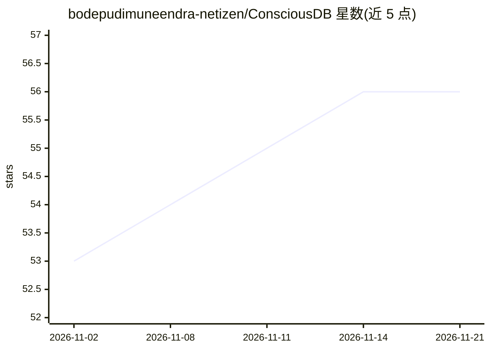

# bodepudimuneendra-netizen/ConsciousDB

⭐ 56 · Python · Apache-2.0 · 推送 2026-11-02 · [GitHub](https://github.com/bodepudimuneendra-netizen/ConsciousDB) · 个人维护

**图数据库无关的 Agentic GraphRAG 框架，可切换本地/云决策模型**

覆盖 Neo4j、Memgraph、Apache AGE、Kùzu 四种图数据库的 Agentic GraphRAG 框架，将 AI 决策层与存储层解耦，两轴各用一个环境变量切换。决策由可替换的 System One 模型（本地 Laya / 云端 Jev）通过 Score/Noul/Choice 三个数学原语完成，管线为 Ingestion→Pre-Retrieval→Traversal→Post-Retrieval 四阶段，含自定义 A* 遍历与幻觉门控；生成式 LLM 仅在末端合成一次。Ablation 模式并行记录 Laya 与 Jev 的决策到 JSONL，用作微调 Laya 的训练数据。面向在自有图数据库上构建检索问答的开发者。

## 筛选速览

| 维度 | 判定 | 备注 |
|---|---|---|
| AI 角色 | `ai-ecosystem` | LLM/agent 周边工具 |
| 许可风险 | `permissive` | Apache-2.0 |
| 部署形态 | `None` |  |
| 模型依赖 | — | README 未给出锁定关系 |
| 硬件要求 | `gpu-8g` | |
| 安装摩擦 | `medium` | 含编译或系统依赖之一 |
| 成熟度 | — | 结构信号不足 |

## 能力要点

- 4 种图数据库通过统一 BaseGraphClient 接口支持，零代码切换
- Laya（本地 GPU，约 33ms/次）/ Jev（云端 API）可切换决策模型
- 四阶段 19 函数管线：边验证、意图路由、A* 遍历、幻觉门控与引用核验
- Ablation 模式生成 JSONL 日志作为微调本地模型的训练数据

## 适用场景

- 在现有图数据库上叠加 Agentic 检索问答能力
- 通过消融模式收集决策数据以微调本地模型、摆脱 API 依赖
- 本地零 Docker 环境下用 Laya+Kùzu 开发，生产切换 Jev+Neo4j

## 场景标签

`知识图谱` `RAG` · 领域:知识与检索

## 证据(README 行号)

> L9: **ConsciousDB** is a **graph-database-agnostic Agentic GraphRAG framework** — a production-ready intelligence layer 
> L11: Instead of hard-wiring GraphRAG logic to a single database, this framework **completely decouples the AI decision l
> L65: |**AI Decision Model**|Laya (local GPU) ↔ Jev (cloud API) ↔ Ablation (both)|`DECISION_MODEL_BACKEND=laya\|jev\|abla

## 星数曲线

2026-11-02 53 → 2026-11-21 56（+3）

---
*卡片 v1 · prompt 1.4 · 生成 2026-11-18 · 置信度 high · 依据 README sha `b84249c81939` · [字段定义](../../DATASET.md)*
