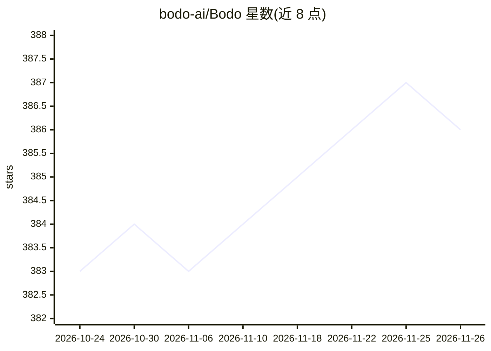

# bodo-ai/Bodo

⭐ 386 · Python · Apache-2.0 · 推送 2026-11-25 · [GitHub](https://github.com/bodo-ai/Bodo) · [官网](https://docs.bodo.ai) · 组织维护

**大规模 Python 数据处理的 Pandas 替代库**

Bodo DataFrames 是面向大规模 Python 数据处理与 AI/ML 负载的 DataFrame 库，作为 Pandas 的直接替换（仅需修改 import），提供 JIT 编译器加速自定义转换，并集成 SQL 引擎。底层基于 MPI 并行技术消除 driver-executor 模型开销，支持流式执行处理超内存数据集，兼容 Iceberg、Snowflake、Parquet 等数据源，并在不支持的操作上回退到原生 Pandas。通过 pip 或 conda 安装，要求 Python 3.10+，支持 Linux x86、Mac 与 Windows。

## 筛选速览

| 维度 | 判定 | 备注 |
|---|---|---|
| AI 角色 | `ai-enhanced` | 去掉 AI 部分产品仍成立 |
| 许可风险 | `permissive` | Apache-2.0 |
| 部署形态 | `library` | 以包/库形式分发 |
| 模型依赖 | — | README 未给出锁定关系 |
| 硬件要求 | — | 无带数字的原话,不猜 |
| 安装摩擦 | `low` | 无编译、无系统依赖或容器化 |
| 成熟度 | — | 结构信号不足 |

## 能力要点

- 一行 import 替换即可并行化 Pandas 工作负载，不支持的操作自动回退原生 Pandas
- 基于 MPI 的真实并行执行，消除 driver-executor 模型运行时开销
- JIT 编译原生支持 Pandas、NumPy、Scikit-learn 的自定义转换加速
- 流式执行处理大于内存的数据集，I/O 支持自动谓词下推与列裁剪

## 适用场景

- 用最小代码改动扩展现有 Pandas 数据管道到集群规模
- 为 AI/ML 工作流加速大规模数据预处理
- 处理超出单机内存的大数据集
- 在 Python 中运行高性能 SQL 查询

## 场景标签

 · 领域:数据科学/分布式数据处理

## 证据(README 行号)

> L11: Bodo DataFrames is a high performance DataFrame library for large scale Python data processing, AI/ML use cases.
> L45: - Intuitive APIs for simplifying and scaling AI workloads.

## 星数曲线

2026-10-24 383 → 2026-11-26 386（+3）

---
*卡片 v1 · prompt 1.4 · 生成 2026-11-25 · 置信度 high · 依据 README sha `7be05205a605` · [字段定义](../../DATASET.md)*
