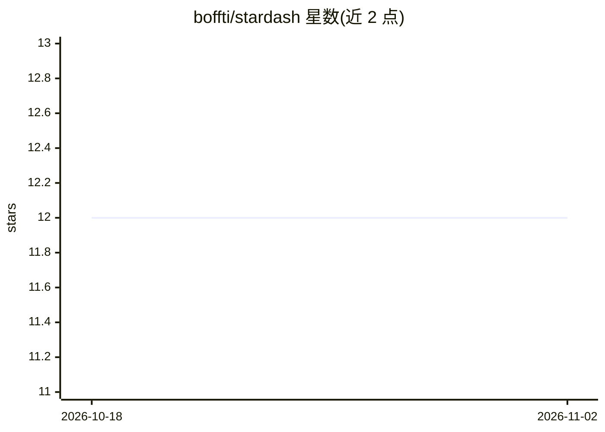

# boffti/stardash

⭐ 12 · TypeScript · MIT · 推送 2026-10-27 · [GitHub](https://github.com/boffti/stardash) · [官网](https://stardash.dev) · 个人维护

**把 GitHub stars 变成 AI 辅助的发现、整理与贡献工作台**

面向用 GitHub stars 做发现与收藏的开发者的开源个人仪表盘：同步最多 5,000 个 starred repos，提供搜索、标签、集合、状态跟踪、趋势视图与 Radar 每日推荐流。AI 功能包括 OpenRouter（Gemini 2.0 Flash）驱动的仓库健康报告（Repo Intel）、issue 贡献机会评分与 AI 贡献简报、语义搜索（查询扩展+重排）、两阶段自动分类。支持 BYOK（OpenRouter/OpenAI/Anthropic），自托管走 Docker Compose。当前 v1 重写中，托管实例暂停服务，计划转向 SQLite、本地优先单容器架构并加入 MCP server。

## 筛选速览

| 维度 | 判定 | 备注 |
|---|---|---|
| AI 角色 | `ai-enhanced` | 去掉 AI 部分产品仍成立 |
| 许可风险 | `permissive` | MIT |
| 部署形态 | `self-host` | docker 或自建部署 |
| 模型依赖 | locked-api |  |
| 硬件要求 | — | 无带数字的原话,不猜 |
| 安装摩擦 | `low` | 无编译、无系统依赖或容器化 |
| 成熟度 | — | 结构信号不足 |

## 能力要点

- 同步最多 5,000 个 starred repos，提供搜索、标签、集合、状态跟踪与趋势视图
- AI 仓库健康报告（0-100 健康分）与 issue 贡献机会评分、一键 AI 贡献简报
- AI 语义搜索（查询扩展+两遍重排）与两阶段自动分类（最多 500 repos/次）
- BYOK 支持 OpenRouter/OpenAI/Anthropic，自托管无配额限制

## 适用场景

- 整理和检索我收藏的大量 GitHub starred 仓库
- 用 AI 健康报告评估一个仓库是否值得采用或贡献
- 从收藏的仓库里发现适合自己上手的开源 issue
- 每天收到符合自己兴趣的新仓库推荐（Radar）

## 场景标签

`语义搜索` `知识库管理` · 领域:知识与检索

## 证据(README 行号)

> L29: StarDash is an open-source personal dashboard for developers who use GitHub stars as a discovery and bookmarking sy
> L63: - On-demand deep analysis of any starred repo powered by OpenRouter (Gemini 2.0 Flash)

## 星数曲线

2026-10-18 12 → 2026-11-02 12（+0）

---
*卡片 v1 · prompt 1.4 · 生成 2026-11-01 · 置信度 high · 依据 README sha `ff3620debd45` · [字段定义](../../DATASET.md)*
