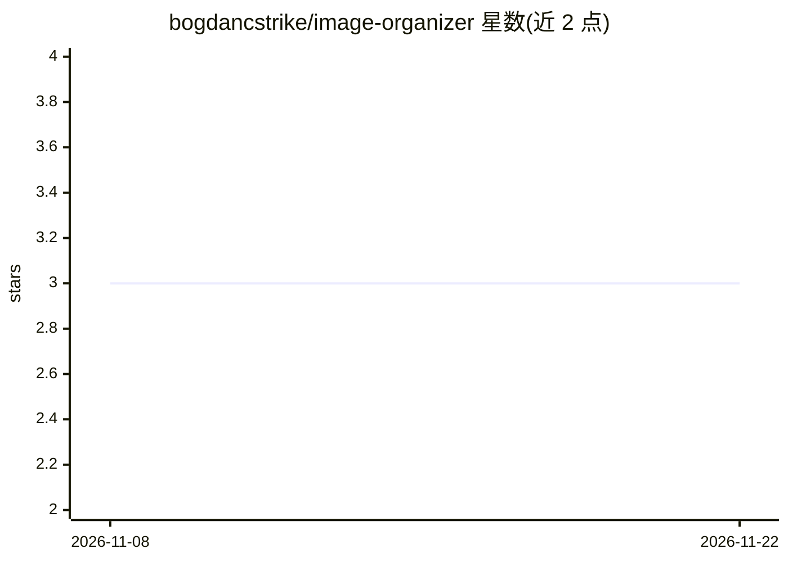

# bogdancstrike/image-organizer

⭐ 3 · Python · MIT · 推送 2026-11-02 · [GitHub](https://github.com/bogdancstrike/image-organizer) · 个人维护

**本地 AI 照片整理工具：按内容分拣成相册，可撤销**

基于 Docker Compose 部署的 FastAPI + React 应用，读取本地照片与视频文件夹，用 CLIP ViT-B/32（ONNX/CPU）识别内容并生成文件夹结构，支持人脸识别（YuNet + SFace）、按日期/GPS/人物/地点等多种分拣模式，以及摄影师向的挑选流程（模糊、闭眼、曝光、连拍择优）。计划-审阅-应用-撤销的工作流，每次操作有日志可回滚。默认完全离线运行；接入 OpenAI key 后启用 AI 命名与辅助分拣，属可选功能。支持 40+ 图像格式与 RAW + JPEG 配对处理，输出 Lightroom/Capture One 的 .xmp sidecar。

## 筛选速览

| 维度 | 判定 | 备注 |
|---|---|---|
| AI 角色 | `ai-native` | 本体是模型或模型工具 |
| 许可风险 | `permissive` | MIT |
| 部署形态 | `self-host` | docker 或自建部署 |
| 模型依赖 | — | README 未给出锁定关系 |
| 硬件要求 | — | 无带数字的原话,不猜 |
| 安装摩擦 | `low` | 无编译、无系统依赖或容器化 |
| 成熟度 | — | 结构信号不足 |

## 能力要点

- CLIP/SigLIP 本地内容识别，无需标签即可按主题分拣
- 人脸识别分人建夹，可上传人脸定向归档
- Culling 流程：模糊/闭眼/曝光/连拍择优，并写 .xmp 评分给 Lightroom/Capture One
- 全部操作经 Apply/Undo 日志，可跨重启撤销

## 适用场景

- 整理手机相册或 Downloads 里的几千张杂乱照片
- 摄影师拍摄后快速挑选（cull）一组片子并标星
- 按旅行 GPS 轨迹或人物整理家庭照片
- 为 Instagram 内容按视觉吸引力筛选素材

## 场景标签

`人脸识别` · 领域:感知与多模态

## 证据(README 行号)

> L27: **Auto Image Organizer** looks at every photo and video, understands what it shows, and proposes a clean folder
> L35: - 🧠 **Understands content.** CLIP sorts *outfits*, *mountains*, *studio light*, *food & cafés*, *screenshots* … no 
> L145: The local sorting modes work offline without a key. **AI prompt rules require a key** and send instructions plus t

## 星数曲线

2026-11-08 3 → 2026-11-22 3（+0）

---
*卡片 v1 · prompt 1.4 · 生成 2026-11-22 · 置信度 mid · 依据 README sha `614a67ac9ea1` · [字段定义](../../DATASET.md)*
