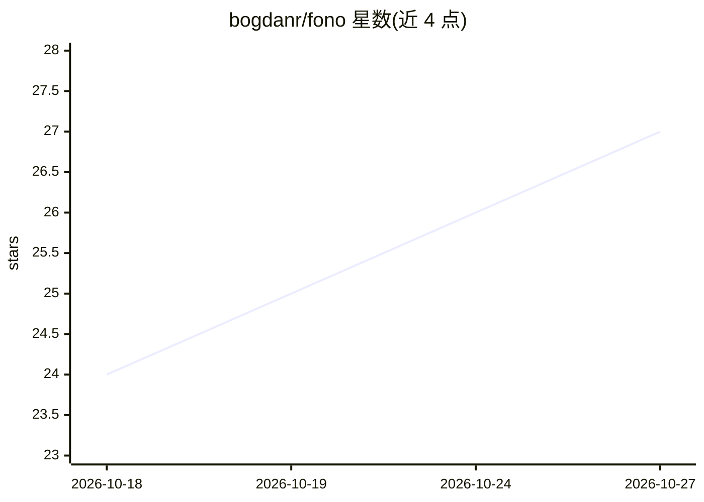

# bogdanr/fono

⭐ 27 · Rust · GPL-3.0 · 推送 2026-10-12 · [GitHub](https://github.com/bogdanr/fono) · [官网](https://fono.page) · 个人维护

**Linux 本地优先的语音听写与语音助手（单二进制全栈）**

面向 Linux 桌面用户的语音工具：按热键说话即可将文字打进任意焦点窗口（听写），或按另一键与 AI 对话并流式朗读回复。单个约 22-60 MB 二进制内置 Whisper 语音识别、TTS、本地 LLM（llama.cpp）、唤醒词与说话人识别；每个阶段均可单独切换到云服务商。支持 X11/Wayland、Vulkan 跨厂商 GPU 加速，可作为 Wyoming 服务端与 OpenAI/Ollama 兼容 API 供局域网设备（Home Assistant 等）调用；macOS 与 Windows 移植为实验性。

## 筛选速览

| 维度 | 判定 | 备注 |
|---|---|---|
| AI 角色 | `ai-native` | 本体是模型或模型工具 |
| 许可风险 | `viral` | GPL-3.0 |
| 部署形态 | `desktop` | 安装包/桌面程序 |
| 模型依赖 | local-ok | 支持本地模型 |
| 硬件要求 | — | 无带数字的原话,不猜 |
| 安装摩擦 | `low` | 无编译、无系统依赖或容器化 |
| 成熟度 | `idea` | |

## 能力要点

- 单二进制内置 STT/TTS/本地 LLM/唤醒词/说话人识别全栈
- F7 听写、F8 语音问答双热键，支持推送式与长按两种按键模式
- 每阶段（STT/润色/助手/TTS）可独立切换本地或云服务商，热重载
- 以 Wyoming 协议与 OpenAI/Ollama 兼容 API 服务整个局域网，含 Docker 容器

## 适用场景

- 在任意 Linux 应用里用语音输入文字
- 免云端账号获得本地语音问答助手
- 让 Home Assistant、编辑器或 MCP 编程 agent 复用同一语音后端

## 场景标签

`语音 Agent` `语音识别` · 领域:对话与助手

## 证据(README 行号)

> L5: Press a key and speak, and Fono types into any app, answers as a voice assistant,
> L62: - 🎙️ **It does everything voice.** Dictate into any window, ask a question and hear the answer, or drive your tools
> L65: - 🔒 **Local-first, actually.** With the default setup nothing leaves your machine. Whisper speech-to-text and a sha

## 星数曲线

2026-10-18 24 → 2026-10-27 27（+3）

---
*卡片 v1 · prompt 1.4 · 生成 2026-10-26 · 置信度 high · 依据 README sha `bd978d65f6db` · [字段定义](../../DATASET.md)*
