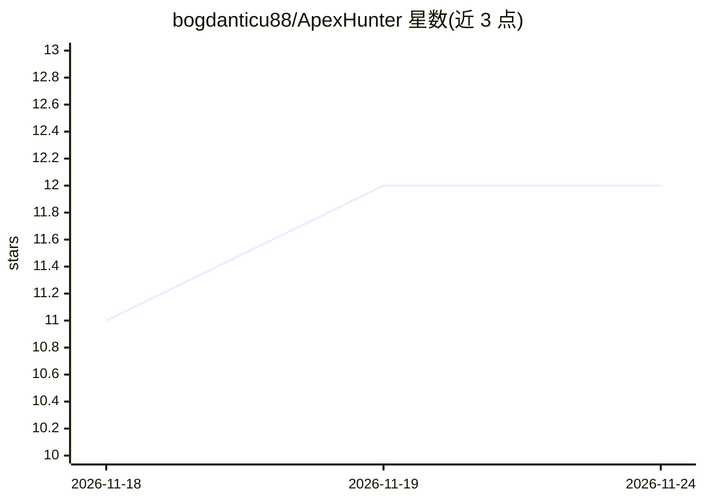

# bogdanticu88/ApexHunter

⭐ 12 · Python · MIT · 推送 2026-03-04 · [GitHub](https://github.com/bogdanticu88/ApexHunter) · 个人维护

**为 SOC/DFIR 分析师执行 YAML 威胁狩猎剧本的本地 LLM 工具**

面向高级 SOC 分析师与 DFIR 专业人员的自主威胁狩猎剧本执行器：用 YAML 定义狩猎剧本，对取证工件（EVTX、CSV、JSON、Parquet）执行查询，通过本地 Ollama 模型自主生成 SQL 查询、对发现进行分诊与关联，并映射到 MITRE ATT&CK。离线优先设计，所有数据处理在本地完成，依赖 DuckDB 进行内存内分析，输出 Markdown/HTML 报告与交互式仪表盘。需 Python 3.9+ 及本地 Ollama 实例。

## 筛选速览

| 维度 | 判定 | 备注 |
|---|---|---|
| AI 角色 | `ai-native` | 本体是模型或模型工具 |
| 许可风险 | `permissive` | MIT |
| 部署形态 | `library` | 以包/库形式分发 |
| 模型依赖 | local-ok | 支持本地模型 |
| 硬件要求 | — | 无带数字的原话,不猜 |
| 安装摩擦 | `low` | 无编译、无系统依赖或容器化 |
| 成熟度 | — | 结构信号不足 |

## 能力要点

- YAML 剧本驱动，对 EVTX/CSV/JSON/Parquet 取证日志执行狩猎步骤
- 本地 Ollama 模型（Mistral、Llama3）自主生成 SQL 查询与分诊发现
- 基于 DuckDB 的 SQL 标准内存内分析，离线优先、数据不出内网
- 生成 Markdown/HTML 报告、Mermaid 时间线与 MITRE ATT&CK 层映射

## 适用场景

- 对 Windows 事件日志与 Sysmon 遥测做自动化威胁狩猎
- 在气隙/敏感环境中离线执行取证分析
- 按假设让 LLM 动态生成调查逻辑（Discovery Mode）
- 产出可呈报管理层的狩猎报告与 ATT&CK 映射

## 场景标签

`网络安全` · 领域:学习与行业

## 证据(README 行号)

> L16: **ApexHunter** is an autonomous, agentic threat hunting playbook executor designed for senior SOC analysts and DFIR
> L22: - **Agentic Reasoning**: Uses local Ollama models (Mistral, Llama3) to autonomously generate SQL queries and triage
> L28: - **🛡️ Multi-Engine Execution**: Run SQL-standard queries via **DuckDB** for blazing-fast in-memory analysis.

## 星数曲线

2026-11-18 11 → 2026-11-24 12（+1）

---
*卡片 v1 · prompt 1.4 · 生成 2026-11-18 · 置信度 high · 依据 README sha `c5fcb6360576` · [字段定义](../../DATASET.md)*
