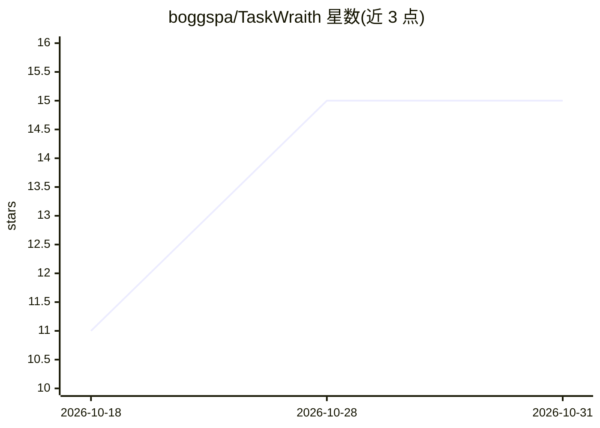

# boggspa/TaskWraith

⭐ 15 · TypeScript · Apache-2.0 · 推送 2026-10-27 · [GitHub](https://github.com/boggspa/TaskWraith) · 组织维护

**本地优先的桌面控制台：统一运行与审查多家 AI 编码 agent**

基于 Electron 的本地优先桌面应用，用于在用户自己的仓库上运行与审查多个 AI 编码 agent：可将 Codex、Claude Code、Cursor、Grok、Mistral、Pi 及本地 Ollama 模型接入同一界面，每个席位有独立角色、权限姿态与审批记录，支持多 agent Ensemble 在共享 transcript 中协作与互审，并提供 Diff Studio 审查、本地历史存储与 Multiview 工作区。不捆绑或绕过 provider 凭证，用户需自行安装并登录各 provider CLI。提供 macOS/Windows/Linux 安装包与 npm 源码构建方式，另有 TestFlight 测试中的 iOS 伴侣应用（非独立 AI 应用）。

## 筛选速览

| 维度 | 判定 | 备注 |
|---|---|---|
| AI 角色 | `ai-ecosystem` | LLM/agent 周边工具 |
| 许可风险 | `permissive` | Apache-2.0 |
| 部署形态 | `None` |  |
| 模型依赖 | local-ok | 支持本地模型 |
| 硬件要求 | — | 无带数字的原话,不猜 |
| 安装摩擦 | `low` | 无编译、无系统依赖或容器化 |
| 成熟度 | — | 结构信号不足 |

## 能力要点

- 多家 provider 的编码 agent 汇入同一桌面应用与线程
- 逐席位权限姿态与 TaskWraith 代理的审批、活动与 diff 审查
- 多 agent Ensemble 在共享 transcript 中协作与互审
- 工作区、本地历史与审批记录保存在本机

## 适用场景

- 在同一桌面应用中并行管理多家编码 agent 的工作
- 以只读姿态起步、经审批后才让改动落盘
- 在共享线程中组建多 agent 小组协作并互审 diff

## 场景标签

`多智能体` `编码 Agent` · 领域:Agent 开发

## 证据(README 行号)

> L7:  A local-first desktop workbench for running and reviewing AI coding agents
> L26: TaskWraith coordinates coding agents from multiple providers in one desktop app.

## 星数曲线

2026-10-18 11 → 2026-10-31 15（+4）

---
*卡片 v1 · prompt 1.4 · 生成 2026-10-30 · 置信度 high · 依据 README sha `c8008253cd1b` · [字段定义](../../DATASET.md)*
