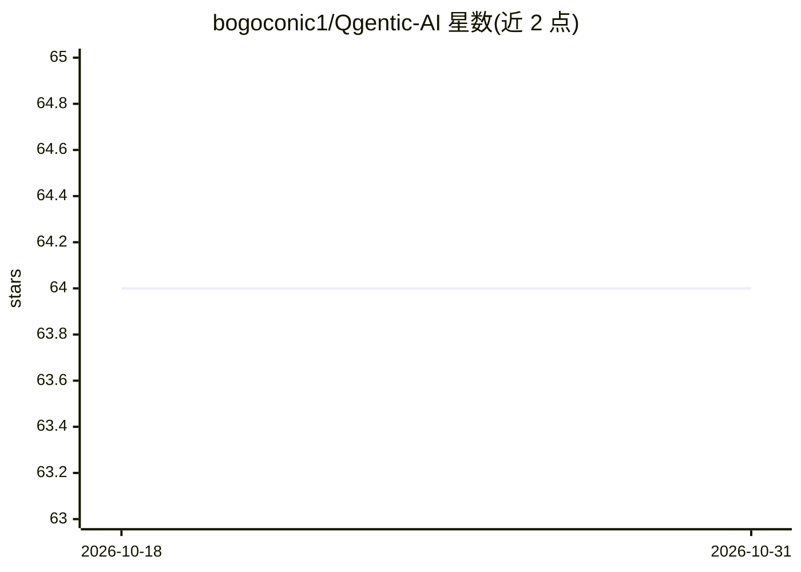

# bogoconic1/Qgentic-AI

⭐ 64 · Python · 推送 2026-09-30 · [GitHub](https://github.com/bogoconic1/Qgentic-AI) · 个人维护

**LLM agent 自动解决 Kaggle 竞赛的 ML 工程栈**

自动化机器学习工程系统：LLM 驱动的多 agent（MainAgent、Researcher 等）读取问题描述，生成技术方案与代码，在本地 CUDA GPU 上运行，分析结果并持续迭代，当前面向 Kaggle 竞赛，可扩展到非竞赛任务。用户通过 GOAL.md 等配置目标，配置 OpenAI/Anthropic/HF/Kaggle 等 API key，经 conda 环境（Python 3.12）启动。运行产物含 JSONL 审计日志、想法池与版本化提交文件，另提供本地 Flask 查看器浏览完整对话轨迹并导出 HTML。README 列有两项竞赛的奖牌成绩。

## 筛选速览

| 维度 | 判定 | 备注 |
|---|---|---|
| AI 角色 | `ai-ecosystem` | LLM/agent 周边工具 |
| 许可风险 | `none` | — |
| 部署形态 | `None` |  |
| 模型依赖 | — | README 未给出锁定关系 |
| 硬件要求 | — | 无带数字的原话,不猜 |
| 安装摩擦 | `medium` | 含编译或系统依赖之一 |
| 成熟度 | — | 结构信号不足 |

## 能力要点

- LLM agent 自动生成技术方案、代码并在本地运行迭代
- 产出 JSONL 审计日志、想法池与版本化开发产物
- 本地 Flask 查看器渲染完整轨迹，可导出单文件 HTML 并以 gist 分享
- Weights & Biases / Weave 追踪支持

## 适用场景

- 让 agent 自动端到端打 Kaggle 竞赛
- 在服务器上运行 ML 任务并追踪 agent 的每一步决策
- 导出完整运行轨迹供复盘或分享

## 场景标签

`多智能体` `数据分析` · 领域:Agent 开发

## 证据(README 行号)

> L3: Qgentic-AI is an automated ML engineering stack. LLM-driven agents take a problem description, produce a technical p
> L79: `--slug` triggers a `kagglehub` download into `task/<slug>/`. Run id defaults to a timestamp. Main Agent runs indef

## 星数曲线

2026-10-18 64 → 2026-10-31 64（+0）

---
*卡片 v1 · prompt 1.4 · 生成 2026-10-24 · 置信度 high · 依据 README sha `d2934ef47a6a` · [字段定义](../../DATASET.md)*
