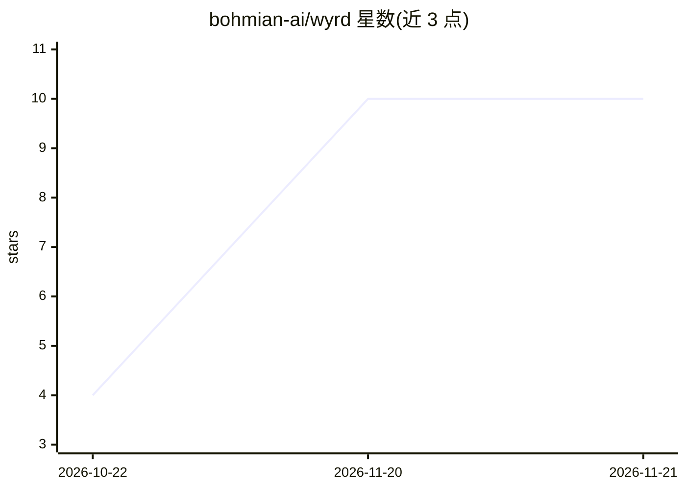

# bohmian-ai/wyrd

⭐ 10 · Rust · Apache-2.0 · 推送 2026-11-19 · [GitHub](https://github.com/bohmian-ai/wyrd) · [官网](https://docs.bohmian.ai/) · 组织维护

**为应用构建实时验证工作流的开源组件集**

Wyrd 提供用于构建验证系统的开源组件：以 YAML 声明需求并绑定 Verifier，应用向验证引擎发送结果并获取带理由的裁决，数据平面 Bifrost 记录遥测与证据供 SQL 查询。支持 Python、Rust、TypeScript SDK、CLI、MCP 与 HTTP 调用同一服务器。运行依赖 PostgreSQL 16、Python 3.11 与对象存储；定位为验证层，不做模型托管、训练或运行时。

## 筛选速览

| 维度 | 判定 | 备注 |
|---|---|---|
| AI 角色 | `ai-ecosystem` | LLM/agent 周边工具 |
| 许可风险 | `permissive` | Apache-2.0 |
| 部署形态 | `library` | 以包/库形式分发 |
| 模型依赖 | — | README 未给出锁定关系 |
| 硬件要求 | — | 无带数字的原话,不猜 |
| 安装摩擦 | `low` | 无编译、无系统依赖或容器化 |
| 成熟度 | — | 结构信号不足 |

## 能力要点

- 声明式 YAML 定义 Verifier，声明带版本管理
- Bifrost 数据平面以 SQL 查询证据与遥测
- Python/Rust/TypeScript SDK、CLI、MCP、HTTP 共用同一服务器
- 支持运行时验证、策略验证、Agent 评估、漂移监控等用例

## 适用场景

- 客服 Agent 回复在送达客户前先通过策略校验
- 对部署模型做运行时监控与版本级验证
- 对长时运行的 Agent 工作流做持续检查
- 在真实流量上运行与 CI 相同的检查并保留结果

## 场景标签

`LLM 可观测性` `模型评测` · 领域:评测与运维

## 证据(README 行号)

> L79:  Your app, CI, and your coding agent call one Wyrd server. CI and your app declare Services and Verifiers; your app
> L110: Wyrd verifies your system; your code runs it. Your app owns its code, models, and data, and decides what to do wit

## 星数曲线

2026-10-22 4 → 2026-11-21 10（+6）

---
*卡片 v1 · prompt 1.4 · 生成 2026-11-20 · 置信度 high · 依据 README sha `2480d0a35c5d` · [字段定义](../../DATASET.md)*
