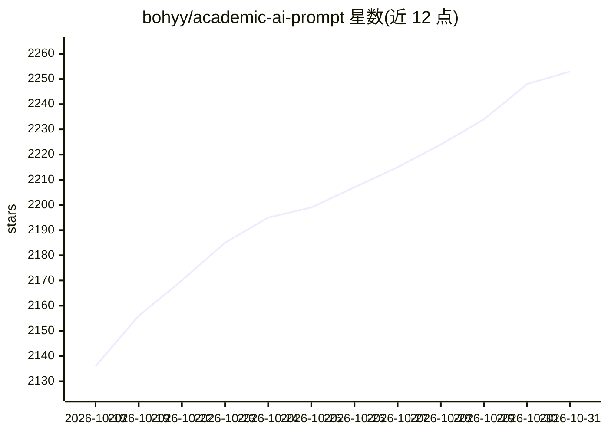

# bohyy/academic-ai-prompt

⭐ 2,253 · MIT · 推送 2026-09-02 · [GitHub](https://github.com/bohyy/academic-ai-prompt) · 个人维护 · 中文 README

**面向研究生的学术研究 AI Prompt 合集（89+条）**

一套中文学术研究 AI 提示词库：89+个 Prompt 覆盖论文选题（生成、5维度评估、论证模板）、论文查找（8个方案）、文献综述框架、论文写作与文本优化（9个润色/降AI率/扩缩写 Prompt），附 1 个 Excel 加权评估表、3 个论证模板和 3 张流程图。使用方式为复制 Prompt 填入个人信息后粘贴到 ChatGPT 或 Claude，本仓库不含代码，无需安装。提示词与模板文件以中文为主，README 提供中英双语；文中耗时与效果数字为原项目自述，README 已声明非经验证的评测结果。

## 筛选速览

| 维度 | 判定 | 备注 |
|---|---|---|
| AI 角色 | `ai-knowledge` | 知识聚合/清单类 |
| 许可风险 | `permissive` | MIT |
| 部署形态 | `None` |  |
| 模型依赖 | — | README 未给出锁定关系 |
| 硬件要求 | — | 无带数字的原话,不猜 |
| 安装摩擦 | `low` | 无编译、无系统依赖或容器化 |
| 成熟度 | — | 结构信号不足 |

## 能力要点

- 89+ 个 Prompt 覆盖选题、查找、综述、写作全流程
- 9 个文本优化 Prompt（润色、降AI率、扩写、缩写等）
- 配套 Excel 5维度加权评估表与 3 个论证模板
- README 双语，声明 AI 生成内容需人工核验（如 Google Scholar 验证文献）

## 适用场景

- 研究生用系统流程生成并评估论文选题
- 让 AI 推荐相关论文清单再人工验证
- 借助 Prompt 搭建文献综述框架并优化论文文本

## 场景标签

`提示工程` `科研工具` · 领域:Agent 开发

## 证据(README 行号)

> L15: > **一套为研究生和学术研究者设计的完整AI Prompt库**
> L17: > 89+个精心设计的Prompt，覆盖从论文选题到文献综述的全流程
> L403: |Topic-selection prompts|论文选题AI提示词库.md|

## 星数曲线

2026-10-18 2,136 → 2026-10-31 2,253（+117）

---
*卡片 v1 · prompt 1.4 · 生成 2026-10-21 · 置信度 high · 依据 README sha `6dfcfbd5d6ee` · [字段定义](../../DATASET.md)*
