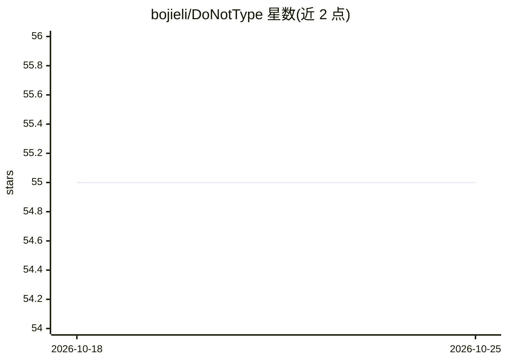

# bojieli/DoNotType

⭐ 55 · Swift · MIT · 推送 2026-10-03 · [GitHub](https://github.com/bojieli/DoNotType) · 个人维护

**开源语音听写工具：结合屏幕上下文正确拼写专有名词**

面向 macOS/Windows/Android/iOS 用户的语音听写应用：默认保留原话，用聚焦应用的屏幕文本（辅助功能树/UI Automation/截图）纠正项目名、缩写与术语拼写，录音内容为权威。提供 Dictate/Rewrite/Translate 三种模式、个人词典、文件转录与 CLI。自带 API key，无账号无中间服务器；支持 Gemini 默认后端及 OpenRouter、vLLM、llama.cpp 等。macOS/Android 提供预构建包，iOS 需源码构建，Windows 暂仅以源码形式提供。

## 筛选速览

| 维度 | 判定 | 备注 |
|---|---|---|
| AI 角色 | `ai-native` | 本体是模型或模型工具 |
| 许可风险 | `permissive` | MIT |
| 部署形态 | `desktop` | 安装包/桌面程序 |
| 模型依赖 | local-ok | 支持本地模型 |
| 硬件要求 | — | 无带数字的原话,不猜 |
| 安装摩擦 | `medium` | 含编译或系统依赖之一 |
| 成熟度 | — | 结构信号不足 |

## 能力要点

- 屏幕上下文在 500ms 预算内采集，仅用于拼写纠正
- 三种模式：Dictate/Rewrite/Translate，原始转写始终保留
- 无 DoNotType 账号/服务器/遥测，请求直连所选 provider
- 四平台客户端共享同一版本化 prompt，提供 CLI 与文件转录

## 适用场景

- 口述含专有名词的技术内容并得到正确拼写
- 用 CLI 转录录音文件并生成摘要/行动项
- 跨 macOS/Windows/Android/iOS 统一的语音输入

## 场景标签

`语音识别` `AI 写作` · 领域:内容生成

## 证据(README 行号)

> L7:  Open-source voice dictation that keeps your wording by default,
> L31: translating it into keystrokes. DoNotType turns that bandwidth into text at your cursor:
> L171: |**Provider choice**|Google Gemini by default, OpenRouter, self-hosted vLLM or llama.cpp, and speech-recognition s

## 星数曲线

2026-10-18 55 → 2026-10-25 55（+0）

---
*卡片 v1 · prompt 1.4 · 生成 2026-10-24 · 置信度 high · 依据 README sha `a743df20c33f` · [字段定义](../../DATASET.md)*
