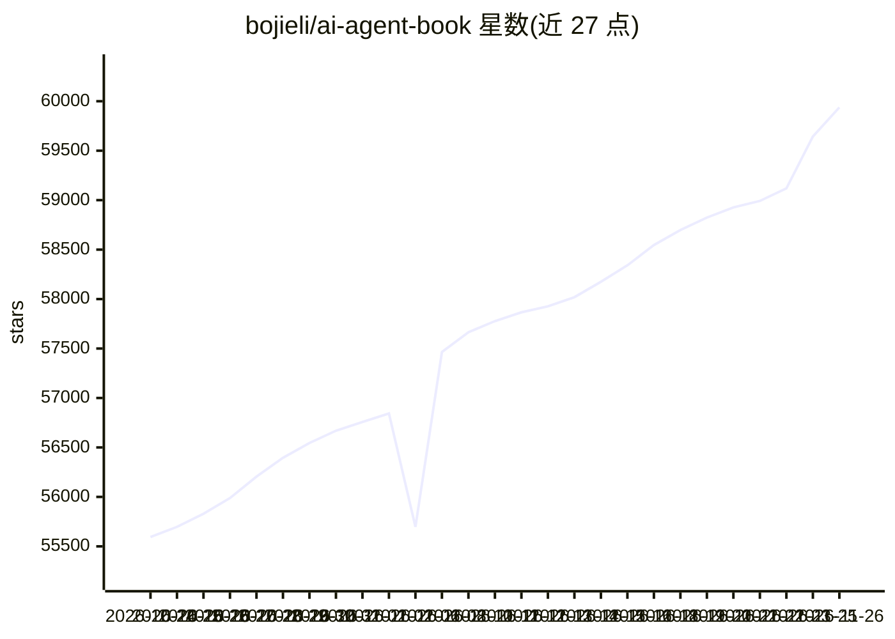

# bojieli/ai-agent-book

⭐ 59,938 · Python · Apache-2.0 · 推送 2026-11-25 · [GitHub](https://github.com/bojieli/ai-agent-book) · 个人维护 · 中文 README

**AI Agent 原理与工程实践的开源书籍：10 章正文+110 个配套实验**

李博杰著作的开源主仓库，围绕「Agent = LLM + 上下文 + 工具」公式，以 10 章正文覆盖上下文工程、记忆与 RAG、MCP 工具、Coding Agent、评估、后训练、多 Agent 协作等主题，配 110 个可运行的 Python 实验（Python 3.11–3.13，uv/pip 按章节安装依赖）。提供 15 种语言的 PDF/EPUB 下载与在线阅读；自行编译 PDF 需 pandoc/xelatex/ElegantBook。第 6–10 章部分实验需另行克隆 22 个外部仓库。

## 筛选速览

| 维度 | 判定 | 备注 |
|---|---|---|
| AI 角色 | `ai-knowledge` | 知识聚合/清单类 |
| 许可风险 | `permissive` | Apache-2.0 |
| 部署形态 | `library` | 以包/库形式分发 |
| 模型依赖 | local-ok | 支持本地模型 |
| 硬件要求 | — | 无带数字的原话,不猜 |
| 安装摩擦 | `medium` | 含编译或系统依赖之一 |
| 成熟度 | — | 结构信号不足 |

## 动量与使用信号

- 维护:`active` — 距上次 push 9.7 天,年发版 1,89 位贡献者
- 涨星:近 1 天 **+162**(自 20261016 起算)
- 下载:GitHub Release 附件 累计 49,995(1 个 release)
- 平台:— · 协议:MCP / OLLAMA

## 能力要点

- 10 章开源正文 + 110 个配套实验，实验代码由 coding agent 生成
- 15 种语言 PDF/EPUB 下载与在线阅读，每次推送自动重建
- 实验统一支持 Python 3.11–3.13，用 uv.lock 提供可复现环境
- 第 6–10 章 22 个外部复现仓库以固定 SHA 一键克隆

## 适用场景

- 系统学习 AI Agent 的上下文工程、工具调用与评估方法
- 借助配套实验动手实现一个 coding agent
- 查阅读者参考答案与思考题，参与社区讨论勘误

## 场景标签

`教程课程` · 领域:学习与行业

## 证据(README 行号)

> L10: **Agent = LLM + 上下文 + 工具**——本书围绕这个核心公式，用 10 章把 AI Agent 从原理讲到工程实战。全书正文、配图、**110 个配套实验**全部开源，欢迎亲手把实验跑一遍。
> L90: 也可以在仓库页面选择 **Code → Download ZIP** 下载。实验按章节组织在 `chapter1/` 至 `chapter10/` 中；查找“实验 X-Y”时，先打开对应的 `chapterX/README.md`

## 星数曲线

2026-10-24 55,595 → 2026-11-26 59,938（+4,343）

---
*卡片 v1 · prompt 1.4 · 生成 2026-11-26 · 置信度 high · 依据 README sha `4bb9fa9898fb` · [字段定义](../../DATASET.md)*
