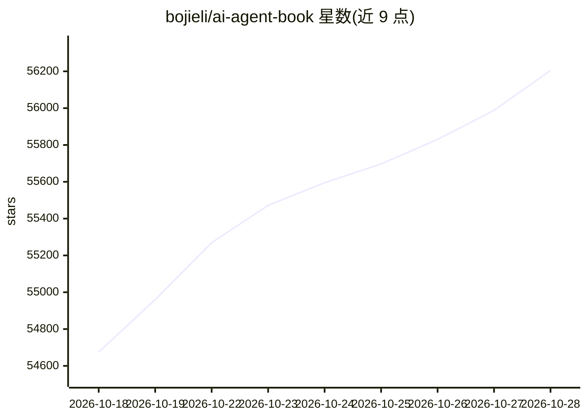

# bojieli/ai-agent-book

⭐ 56,395 · Python · Apache-2.0 · 推送 2026-10-08 · [GitHub](https://github.com/bojieli/ai-agent-book) · 个人维护 · 中文 README

**面向工程师的 AI Agent 开源书：10 章正文加 109 个配套实验**

开源图书仓库，正文按 Agent = LLM + 上下文 + 工具的框架分 10 章，主题覆盖上下文工程、用户记忆与 RAG、MCP 工具、Coding Agent、评估、后训练与多 Agent 协作。提供 15 种语言的 PDF/EPUB 下载与在线阅读，正文源码为 markdown，可自行编译（需 pandoc/xelatex/ElegantBook）。实验代码统一支持 Python 3.11–3.13，用 uv 或 pip 按章节安装依赖，调用模型需自行配置 API Key；第 6/7/8/10 章部分实验需另行克隆 22 个外部仓库。

## 筛选速览

| 维度 | 判定 | 备注 |
|---|---|---|
| AI 角色 | `ai-knowledge` | 知识聚合/清单类 |
| 许可风险 | `permissive` | Apache-2.0 |
| 部署形态 | `library` | 以包/库形式分发 |
| 模型依赖 | — | README 未给出锁定关系 |
| 硬件要求 | — | 无带数字的原话,不猜 |
| 安装摩擦 | `medium` | 含编译或系统依赖之一 |
| 成熟度 | — | 结构信号不足 |

## 动量与使用信号

- 维护:`active` — 距上次 push 9.7 天,年发版 1,89 位贡献者
- 涨星:近 1 天 **+162**(自 20261016 起算)
- 下载:GitHub Release 附件 累计 49,995(1 个 release)
- 平台:— · 协议:MCP / OLLAMA

## 能力要点

- 10 章正文与 109 个配套实验全部开源（Apache 2.0）
- 15 种语言的 PDF/EPUB 构建与在线阅读，main 分支推送后自动更新
- 实验环境用 uv.lock 固定，按章节 extra 安装依赖
- 配套代码由 coding agent 生成，附思考题参考答案与学习建议

## 适用场景

- 系统学习 AI Agent 的设计原理与工程实践
- 跟着 109 个实验动手实现自己的 coding agent
- 为团队搭建 Agent 评估集与持续改进流程

## 场景标签

`教程课程` · 领域:学习与行业

## 证据(README 行号)

> L10: **Agent = LLM + 上下文 + 工具**——本书围绕这个核心公式，用 10 章把 AI Agent 从原理讲到工程实战。全书正文、配图、**109 个配套实验**全部开源，欢迎亲手把实验跑一遍。
> L64: |1|🚀 **AI Agent 入门**|**Agent = LLM + 上下文 + 工具**；Harness 工程才是竞争力|读|4|
> L91: 运行会调用模型的实验前，请按该实验 README 配置凭据：支持根目录配置的实验可复制 `.env.example` 为 `.env` 并填入至少一个提供商 Key；有些实验要求在自身目录放 `.env` 或直接导出环境变量。只有

## 星数曲线

2026-10-18 54,675 → 2026-10-28 56,205（+1,530）

---
*卡片 v1 · prompt 1.4 · 生成 2026-10-18 · 置信度 high · 依据 README sha `eed8f3398e12` · [字段定义](../../DATASET.md)*
