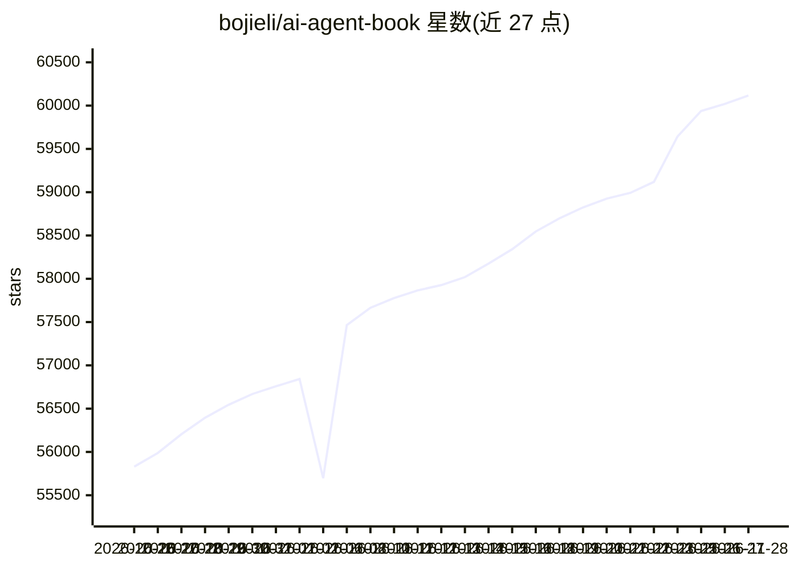

# bojieli/ai-agent-book

⭐ 60,116 · Python · Apache-2.0 · 推送 2026-11-27 · [GitHub](https://github.com/bojieli/ai-agent-book) · 个人维护 · 中文 README

**AI Agent 设计与工程实践的开源中文教材（10 章+110 实验）**

以「Agent = LLM + 上下文 + 工具」为主线的开源书稿仓库，正文 Markdown、配图、110 个按章组织的配套实验全部开源，提供 15 种语言的 PDF/EPUB 构建版与在线阅读。实验统一支持 Python 3.11–3.13，通过 uv.lock 或 pip 按章节安装依赖；调用模型的实验需自行配置 API Key，部分实验可用本地 Ollama。另列出 22 个需自行克隆的外部复现仓库，并明确声明克隆源码不等于实验完成。

## 筛选速览

| 维度 | 判定 | 备注 |
|---|---|---|
| AI 角色 | `ai-knowledge` | 知识聚合/清单类 |
| 许可风险 | `permissive` | Apache-2.0 |
| 部署形态 | `library` | 以包/库形式分发 |
| 模型依赖 | local-ok | 支持本地模型 |
| 硬件要求 | — | 无带数字的原话,不猜 |
| 安装摩擦 | `medium` | 含编译或系统依赖之一 |
| 成熟度 | — | 结构信号不足 |

## 动量与使用信号

- 维护:`active` — 距上次 push 9.7 天,年发版 1,89 位贡献者
- 涨星:近 1 天 **+162**(自 20261016 起算)
- 下载:GitHub Release 附件 累计 49,995(1 个 release)
- 平台:— · 协议:MCP / OLLAMA

## 能力要点

- 10 章正文覆盖上下文工程、记忆/RAG、MCP、Coding Agent、评估、后训练、多 Agent 协作
- 110 个配套实验按章节组织，含本地项目与外部复现轨道
- 15 种语言的 PDF/EPUB 下载与在线阅读，每次推送自动更新构建
- 配套代码由 coding agent 生成，思考题提供参考答案

## 适用场景

- 系统学习 AI Agent 的设计原理与工程实践
- 按章节动手复现实验，构建自己的 coding agent
- 为团队建立 Agent 评估与持续改进的工程方法论

## 场景标签

`教程课程` · 领域:学习与行业

## 证据(README 行号)

> L10: **Agent = LLM + 上下文 + 工具**——本书围绕这个核心公式，用 10 章把 AI Agent 从原理讲到工程实战。全书正文、配图、**110 个配套实验**全部开源，欢迎亲手把实验跑一遍。
> L92: 项目统一支持 **Python 3.11–3.13**。请在仓库根目录按章节安装依赖；将 `ch1` 替换为 `ch2` ~ `ch10` 即可安装对应章节：
> L77: > 💡 **读** = 在 GitHub 网页直接读章节正文（markdown）；**N** = 该章正文实验数，点击查看实现与复现说明。项目类型说明（✅ 可运行 / 📖 复现 / 🚧 设计）见各章 README。

## 星数曲线

2026-10-26 55,830 → 2026-11-28 60,116（+4,286）

---
*卡片 v1 · prompt 1.4 · 生成 2026-11-28 · 置信度 high · 依据 README sha `9d3cfa2d2140` · [字段定义](../../DATASET.md)*
