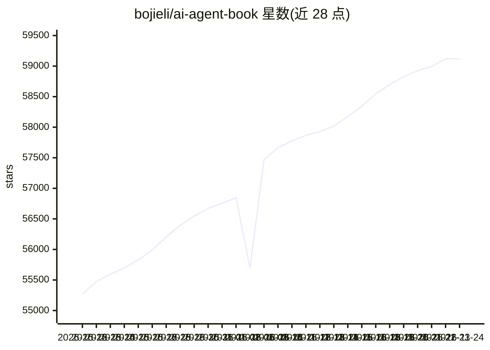

# bojieli/ai-agent-book

⭐ 59,643 · Python · Apache-2.0 · 推送 2026-11-24 · [GitHub](https://github.com/bojieli/ai-agent-book) · 个人维护 · 中文 README

**AI Agent 设计与工程实践的开源书籍，含 109 个配套实验**

《深入理解 AI Agent》开源书稿主仓库，围绕「Agent = LLM + 上下文 + 工具」公式以 10 章覆盖上下文工程、记忆与 RAG、MCP 工具、Coding Agent、评估、后训练与多 Agent 协作。提供 15 种语言的 PDF/EPUB 下载与在线阅读，正文 Markdown 源码开放，附 109 个按章组织的可运行/复现实验，使用 uv/pip 按章节安装 Python 3.11–3.13 环境，模型调用需自配 API Key。

## 筛选速览

| 维度 | 判定 | 备注 |
|---|---|---|
| AI 角色 | `ai-knowledge` | 知识聚合/清单类 |
| 许可风险 | `permissive` | Apache-2.0 |
| 部署形态 | `library` | 以包/库形式分发 |
| 模型依赖 | local-ok | 支持本地模型 |
| 硬件要求 | — | 无带数字的原话,不猜 |
| 安装摩擦 | `medium` | 含编译或系统依赖之一 |
| 成熟度 | — | 结构信号不足 |

## 动量与使用信号

- 维护:`active` — 距上次 push 9.7 天,年发版 1,89 位贡献者
- 涨星:近 1 天 **+162**(自 20261016 起算)
- 下载:GitHub Release 附件 累计 49,995(1 个 release)
- 平台:— · 协议:MCP / OLLAMA

## 能力要点

- 10 章正文与 109 个配套实验全部开源，实验按章节组织于 chapter1–chapter10
- 15 种语言 PDF/EPUB 构建，每次 main 分支推送自动更新
- 实验统一支持 Python 3.11–3.13，提供 uv.lock 可复现环境
- 附录列出 23 个固定到不可变 SHA 的外部复现仓库

## 适用场景

- 系统学习 AI Agent 的设计原理与工程实践
- 按章节动手运行实验，从头实现一个 coding agent
- 为 agent 建立评估集并围绕失败用例做迭代改进

## 场景标签

`教程课程` `Agent 记忆` `多智能体` `编码 Agent` · 领域:Agent 开发

## 证据(README 行号)

> L10: **Agent = LLM + 上下文 + 工具**——本书围绕这个核心公式，用 10 章把 AI Agent 从原理讲到工程实战。全书正文、配图、**109 个配套实验**全部开源，欢迎亲手把实验跑一遍。
> L20: |📚 **10 章** 正文，从基础到生产|📂 **109 个** 配套实验（含本地项目与外部复现轨道）|🌐 **15 种** 语言：中 / 英 / 西 / 印尼 / 阿 / 繁體中文（台灣） / 俄 / 泰米尔 / 越 / 日 

## 星数曲线

2026-10-22 55,269 → 2026-11-24 59,119（+3,850）

---
*卡片 v1 · prompt 1.4 · 生成 2026-11-24 · 置信度 high · 依据 README sha `600f7a696ee8` · [字段定义](../../DATASET.md)*
