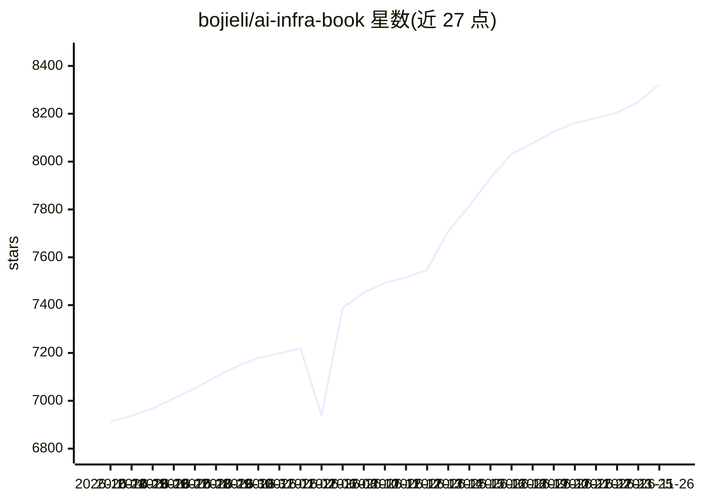

# bojieli/ai-infra-book

⭐ 8,323 · Python · Apache-2.0 · 推送 2026-11-22 · [GitHub](https://github.com/bojieli/ai-infra-book) · [官网](https://bojieli.github.io/ai-infra-book/) · 个人维护 · 中文 README

**面向工程师的 LLM 推理与训练系统设计开源书稿**

李博杰所著开源书稿，含十二章正文、PDF/EPUB 与四种语言在线阅读版。全书从硬件约束与模型架构出发做量化估算，推导 LLM 推理与训练系统设计，覆盖加速器、算子运行时、超节点、数据中心网络、推理优化、分布式推理与训练系统。配套计算工具可用 Python 3.10+ 标准库复算书中数字，experiments/ 目录按章存放实验，需要 GPU 的实验注明硬件与依赖。目标读者为调用过模型 API 或自行运行模型的工程师、系统/网络/芯片从业者及研究人员与学生。

## 筛选速览

| 维度 | 判定 | 备注 |
|---|---|---|
| AI 角色 | `ai-knowledge` | 知识聚合/清单类 |
| 许可风险 | `permissive` | Apache-2.0 |
| 部署形态 | `library` | 以包/库形式分发 |
| 模型依赖 | — | README 未给出锁定关系 |
| 硬件要求 | `cpu-ok` | |
| 安装摩擦 | `low` | 无编译、无系统依赖或容器化 |
| 成熟度 | `idea` | |

## 能力要点

- 提供全书正文、PDF/EPUB 与四语言在线阅读网站，自动发布 Release
- 配套计算工具仅需 Python 3.10+ 标准库，无需 GPU 或模型权重
- experiments/ 按章节组织实验，附运行方法、输入条件与结果记录
- 支持本地构建网站与 PDF/EPUB（Pandoc、XeLaTeX）

## 适用场景

- 系统学习 LLM 推理与训练系统的量化分析方法
- 为推理服务优化查阅批处理、KV 管理、推测解码等机制
- 用配套工具估算自己模型与硬件下的资源需求
- 参与开源书稿的勘误、翻译或实验补充

## 场景标签

`教程课程` · 领域:学习与行业

## 证据(README 行号)

> L1: # 深入理解 AI Infra：量化分析与系统设计
> L21: 更深层的变化是**编程抽象的上移：从操作系统到模型上下文**。传统的操作系统、编译器和硬件要为事先未知的各种程序提供通用能力，系统优化总要在可编程性与性能之间取舍。如今 LLM 成了最重要的应用，从算子执行到分布式调度，都可以针对
> L66: 配套计算工具可以用来复算书中的数字，也可以换一组模型和输入，估算资源需求。工具附有模型配置和结果索引，静态计算只需 Python 3.10+ 标准库，无需 GPU 或模型权重。

## 星数曲线

2026-10-24 6,912 → 2026-11-26 8,323（+1,411）

---
*卡片 v1 · prompt 1.4 · 生成 2026-11-23 · 置信度 high · 依据 README sha `6ec7d50cc1f2` · [字段定义](../../DATASET.md)*
