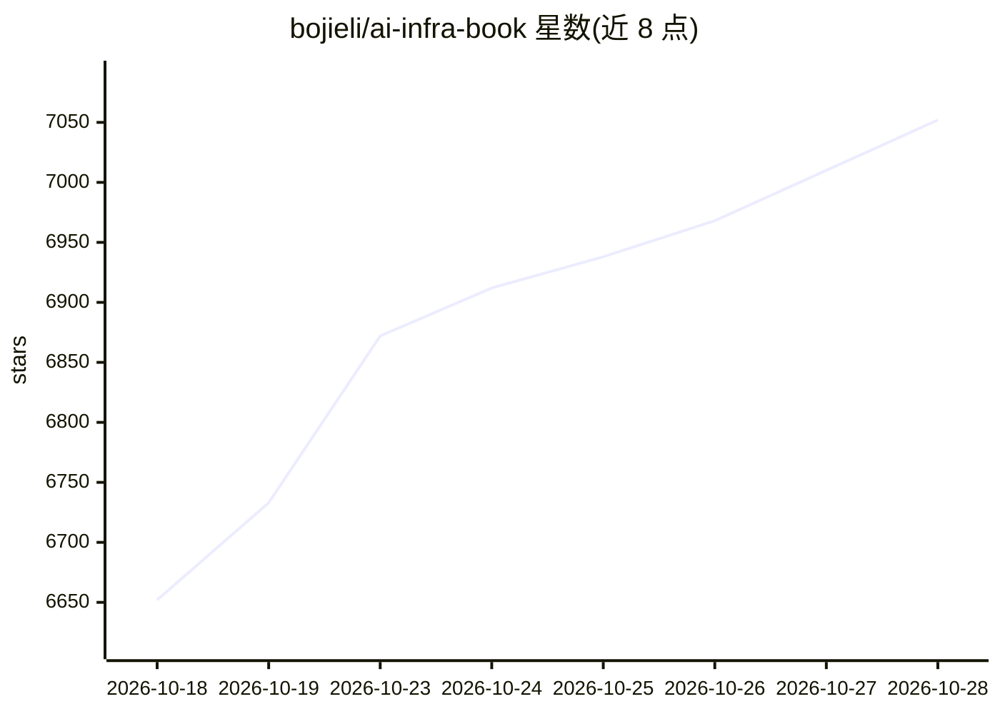

# bojieli/ai-infra-book

⭐ 7,052 · Python · Apache-2.0 · 推送 2026-10-01 · [GitHub](https://github.com/bojieli/ai-infra-book) · [官网](https://bojieli.github.io/ai-infra-book/) · 个人维护 · 中文 README

**LLM 推理与训练系统设计的开源书稿，量化推导 AI Infra**

《深入理解 AI Infra：量化分析与系统设计》开源书稿（李博杰著），《深入理解 AI Agent》姊妹篇。从硬件约束与模型架构出发，通过算力、存储、带宽的数量级估算推导推理与训练系统设计，共 12 章，覆盖模型架构、加速器、算子运行时、超节点、数据中心网络、推理优化、分布式推理与训练系统等。提供 PDF/EPUB/在线阅读四种语言版本，配套静态计算工具（Python 3.10+ 标准库即可运行，无需 GPU）与按章节组织的实验。书稿仍为初稿，持续修订中。

## 筛选速览

| 维度 | 判定 | 备注 |
|---|---|---|
| AI 角色 | `ai-knowledge` | 知识聚合/清单类 |
| 许可风险 | `permissive` | Apache-2.0 |
| 部署形态 | `library` | 以包/库形式分发 |
| 模型依赖 | — | README 未给出锁定关系 |
| 硬件要求 | `cpu-ok` | |
| 安装摩擦 | `low` | 无编译、无系统依赖或容器化 |
| 成熟度 | `idea` | |

## 能力要点

- 12 章正文，方法为从约束推导设计的量化估算
- 配套计算工具复算书中数字，仅需 Python 标准库
- 按章节组织的实验目录，附运行方法与结果记录
- 四种语言版本（中/英/繁中/俄），PDF/EPUB/在线阅读

## 适用场景

- 调用过模型 API 后想弄清模型为什么慢、如何降低成本
- 系统/网络/芯片工程师理解各层设计与模型任务的关联
- 复算书中算例并换成自己的模型和硬件验证结论

## 场景标签

`教程课程` · 领域:学习与行业

## 证据(README 行号)

> L21: 更深层的变化是**编程抽象的上移：从操作系统到模型上下文**。传统的操作系统、编译器和硬件要为事先未知的各种程序提供通用能力，系统优化总要在可编程性与性能之间取舍。如今 LLM 成了最重要的应用，从算子执行到分布式调度，都可以针对
> L29: |章|主题|主要问题|

## 星数曲线

2026-10-18 6,652 → 2026-10-28 7,052（+400）

---
*卡片 v1 · prompt 1.4 · 生成 2026-10-20 · 置信度 high · 依据 README sha `e0f2c800d74b` · [字段定义](../../DATASET.md)*
