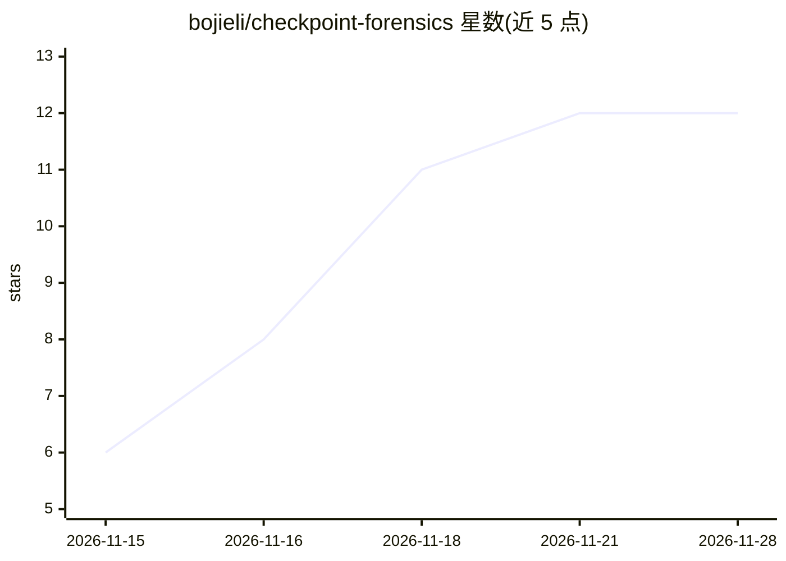

# bojieli/checkpoint-forensics

⭐ 12 · Python · MIT · 推送 2026-11-14 · [GitHub](https://github.com/bojieli/checkpoint-forensics) · [官网](https://01.me/en/2026/11/checkpoint-forensics/) · 个人维护 · 中文 README

**从开源权重模型读取初始化所用 GPU 线程数的取证工具**

对 Checkpoint Forensics 方法的独立复现与扩展：利用训练未触及的 embedding 行保留 PyTorch 初始化时的 GPU 线程数这一现象，通过 grid-stride 布局仿真、种子搜索与验证，从公开检查点读出初始化设备的线程数并映射到 GPU 类别。对 265 个模型完成扫描，输出指纹卡与证据分级（untouched/trained/sign-only/sibling）。需一块 NVIDIA GPU 与 nvcc/cuRAND，内核首次使用时编译；工具明确限定读数不指向芯片型号、所有者或训练位置。

## 筛选速览

| 维度 | 判定 | 备注 |
|---|---|---|
| AI 角色 | `ai-native` | 本体是模型或模型工具 |
| 许可风险 | `permissive` | MIT |
| 部署形态 | `library` | 以包/库形式分发 |
| 模型依赖 | — | README 未给出锁定关系 |
| 硬件要求 | — | 无带数字的原话,不猜 |
| 安装摩擦 | `medium` | 含编译或系统依赖之一 |
| 成熟度 | — | 结构信号不足 |

## 能力要点

- CUDA 填充核仿真（kernels.cu），任意 NVIDIA GPU 可复现其他线程数的写入，与 PyTorch 位级一致
- Philox 计数器式种子搜索：2³² 种子 × 19 线程数在单 GPU 上数秒完成
- 四级证据分级（untouched/trained/sign-only/sibling rows）与指纹卡 JSON 输出
- 通过 HTTP range 请求读取权重，无需下载完整模型

## 适用场景

- 分析公开 LLM 检查点是在哪类 GPU 上初始化的
- 对模型发布谱系（re-release/微调继承）做初始化溯源
- 复现或扩展检查点取证研究的实验结果

## 场景标签

 · 领域:AI 安全/模型取证研究工具

## 证据(README 行号)

> L5: PyTorch fills a new model's weights with random numbers using every thread the GPU has, and the thread count differs
> L29: 1. **Grid-stride layout.** To fill a tensor on a GPU, PyTorch launches `T` threads, where `T` = SMs × threads per S
> L40: Requirements: an NVIDIA GPU (any model; other thread counts are emulated), PyTorch with CUDA, and `nvcc` plus the c

## 星数曲线

2026-11-15 6 → 2026-11-28 12（+6）

---
*卡片 v1 · prompt 1.4 · 生成 2026-11-18 · 置信度 high · 依据 README sha `a1f51ce5ec63` · [字段定义](../../DATASET.md)*
