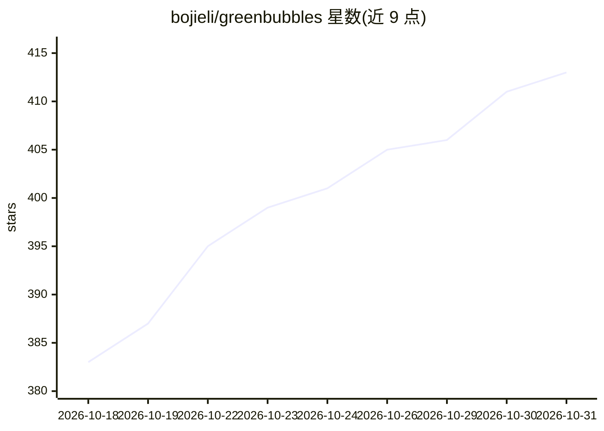

# bojieli/greenbubbles

⭐ 413 · Rust · MIT · 推送 2026-10-24 · [GitHub](https://github.com/bojieli/greenbubbles) · 个人维护 · 中文 README

**让 AI 读取本机微信聊天记录的 macOS 工具，含代理技能**

macOS 命令行工具与桌面应用：直接读取 WeChat 在本地已加密的聊天数据库，无需导出，支持列出会话、读消息、全文搜索、打开附件路径；一次性从运行中的微信提取账户密钥解密。附带 Markdown 格式的 agent skill，可让 Claude Code、Codex、Kimi Code 等编程代理将对话整理成带引用的个人笔记，另有可选的 Gemini 内置摘要。支持 24 词恢复短语的加密备份。研究 alpha，仅限 Apple silicon + macOS 14+，本地存储，不发送消息。

## 筛选速览

| 维度 | 判定 | 备注 |
|---|---|---|
| AI 角色 | `ai-enhanced` | 去掉 AI 部分产品仍成立 |
| 许可风险 | `permissive` | MIT |
| 部署形态 | `None` |  |
| 模型依赖 | — | README 未给出锁定关系 |
| 硬件要求 | — | 无带数字的原话,不猜 |
| 安装摩擦 | `low` | 无编译、无系统依赖或容器化 |
| 成熟度 | `idea` | |

## 能力要点

- 直接读取微信原始加密数据库，无需导出或维护副本
- 提供 SKILL.md 让编程代理把对话整理成带引用的笔记
- 24 词恢复短语的加密备份，可脱离微信查询
- --redact 隐藏电话/邮箱/证件号/链接

## 适用场景

- 在本机搜索和浏览自己的微信聊天记录
- 让 Claude Code 等编程代理把聊天整理成可追溯的个人知识笔记
- 对微信历史做加密备份以备日后查看

## 场景标签

`知识库管理` · 领域:知识与检索

## 证据(README 行号)

> L5:  Enable your AI agents to access your WeChat history in real time.
> L22:  GreenBubbles queries WeChat’s original encrypted databases locally and returns live results to your agent, without
> L24: GreenBubbles is a Mac command-line tool for reading your own WeChat history.

## 星数曲线

2026-10-18 383 → 2026-10-31 413（+30）

---
*卡片 v1 · prompt 1.4 · 生成 2026-10-21 · 置信度 high · 依据 README sha `b49ad938f519` · [字段定义](../../DATASET.md)*
