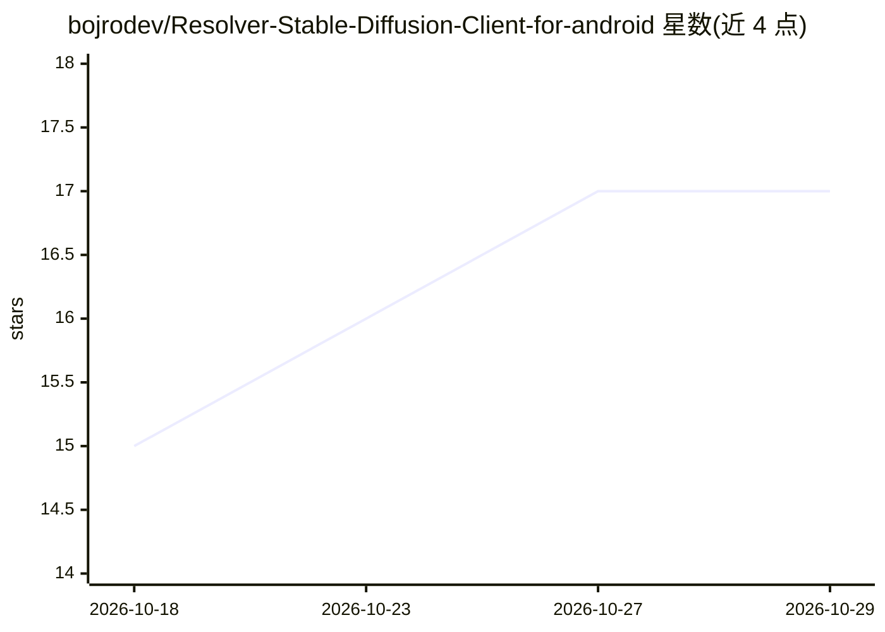

# bojrodev/Resolver-Stable-Diffusion-Client-for-android

⭐ 17 · HTML · GPL-3.0 · 推送 2026-10-21 · [GitHub](https://github.com/bojrodev/Resolver-Stable-Diffusion-Client-for-android) · 个人维护

**安卓端 Stable Diffusion 生成客户端，连接 Forge/ComfyUI 后台**

基于 Capacitor 6.0 与 Java 前台服务的 Android 原生应用，用于通过手机操作 PC 上运行的 WebUI Forge 或 ComfyUI 后端：支持 SDXL、Flux（含 First Block Cache 优化）、Qwen/Z-Image 模式，可执行 ComfyUI 的 .json 工作流并动态生成 UI 控件。生成任务可在息屏/最小化后由前台服务与 Wake Lock 保持运行。另提供元数据分析、WebSocket 实时进度、触屏局部重绘、通过 LM Studio/Ollama 连接本地 LLM 扩写提示词（Magic Prompt），以及 LAN/HTTPS/NGrok 远程连接与远程唤醒。要求 Android 10+ 与已运行的 Forge/ComfyUI 实例，以 GPLv3 发布。

## 筛选速览

| 维度 | 判定 | 备注 |
|---|---|---|
| AI 角色 | `ai-ecosystem` | LLM/agent 周边工具 |
| 许可风险 | `viral` | GPL-3.0 |
| 部署形态 | `desktop` | 安装包/桌面程序 |
| 模型依赖 | — | README 未给出锁定关系 |
| 硬件要求 | — | 无带数字的原话,不猜 |
| 安装摩擦 | `low` | 无编译、无系统依赖或容器化 |
| 成熟度 | — | 结构信号不足 |

## 能力要点

- Java 前台服务 + Wake Lock 支持息屏后台生成
- 执行 ComfyUI .json 工作流并动态生成滑块/下拉等 UI 控件
- 支持 SDXL、Flux（FBC 优化）、Qwen/Z-Image 模式
- Magic Prompt：经 LM Studio/Ollama 调用 PromptMaster v2 扩写提示词

## 适用场景

- 在手机上远程操控 PC 的 Forge/ComfyUI 队列并保持后台生成
- 移动端进行触屏局部重绘（Inpainting）
- 查看并复用历史生成参数（元数据分析）
- 在外网经 HTTPS/NGrok 连接并远程唤醒家里的生成主机

## 场景标签

`图像生成` · 领域:内容生成

## 证据(README 行号)

> L15: **Resolver** is an open-source, high-performance native Android interface for AI image generation. It provides a se
> L68: - A running instance of WebUI Forge or ComfyUI

## 星数曲线

2026-10-18 15 → 2026-10-29 17（+2）

---
*卡片 v1 · prompt 1.4 · 生成 2026-10-29 · 置信度 high · 依据 README sha `60af788f5820` · [字段定义](../../DATASET.md)*
