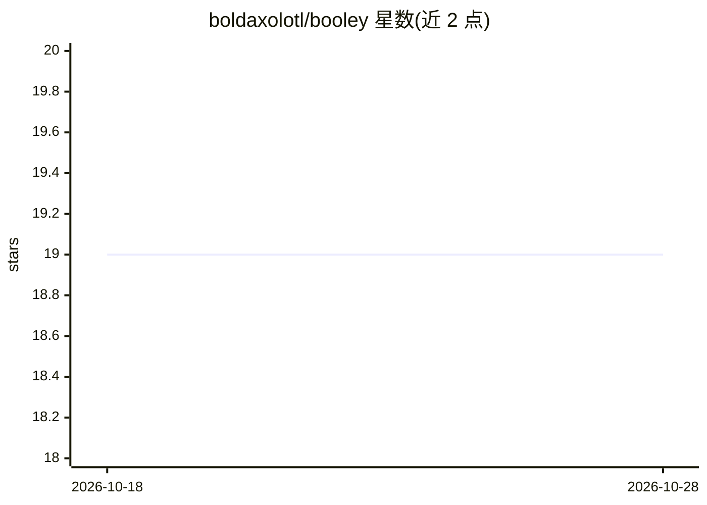

# boldaxolotl/booley

⭐ 22 · Python · Apache-2.0 · 推送 2026-10-28 · [GitHub](https://github.com/boldaxolotl/booley) · 个人维护

**让 Claude Code/Codex 在沙箱中执行 RTL 设计任务的开源 IDE**

面向硬件设计工程师的 agentic RTL IDE：将 Claude Code 或 Codex 作为 Developer Agent 运行于 Docker 沙箱容器中，向其提供真实 EDA 工具（仿真、lint、综合、FPGA 实现），并通过 Goal Mode 以确定性代码核验测试通过、面积、时序、覆盖率等验收标准。提供 sim/lint/synth/fpga 四类 Typed EDA Flows（基于 FuseSoC）、bwave 波形查询、单 VS Code 窗口集成与可复现的团队 Docker 环境。支持 Windows/Linux，不支持 macOS；设计语言限 SystemVerilog/Verilog，不支持 VHDL/UVM。

## 筛选速览

| 维度 | 判定 | 备注 |
|---|---|---|
| AI 角色 | `ai-ecosystem` | LLM/agent 周边工具 |
| 许可风险 | `permissive` | Apache-2.0 |
| 部署形态 | `library` | 以包/库形式分发 |
| 模型依赖 | locked-api |  |
| 硬件要求 | — | 无带数字的原话,不猜 |
| 安装摩擦 | `low` | 无编译、无系统依赖或容器化 |
| 成熟度 | — | 结构信号不足 |

## 能力要点

- Claude Code/Codex 在 Docker 沙箱（受限挂载与网络）内编写 RTL 与测试平台
- Goal Mode 用确定性代码核验面积/时序/覆盖率等指标，不采信 agent 自述
- sim/lint/synth/fpga Typed EDA Flows 基于 FuseSoC，跨工具接口一致
- bwave 波形查询让 agent 从仿真数据回答信号问题

## 适用场景

- 让 AI agent 按验收标准自动完成 RTL 编写与测试平台工作
- 统一团队的可复现 EDA 环境与流程配置
- 在单一 VS Code 窗口内完成 RTL 编辑、EDA 运行与波形调试

## 场景标签

`编码 Agent` · 领域:编码与开发

## 证据(README 行号)

> L10: Booley turns Claude Code or Codex into a capable RTL assistant. It runs the Developer Agent in a sandbox, hands it 
> L21: - **Sandboxed Developer Agent:** Booley treats the agent like a talented junior engineer. It can write RTL and test

## 星数曲线

2026-10-18 19 → 2026-10-28 19（+0）

---
*卡片 v1 · prompt 1.4 · 生成 2026-10-28 · 置信度 high · 依据 README sha `772d485236bd` · [字段定义](../../DATASET.md)*
