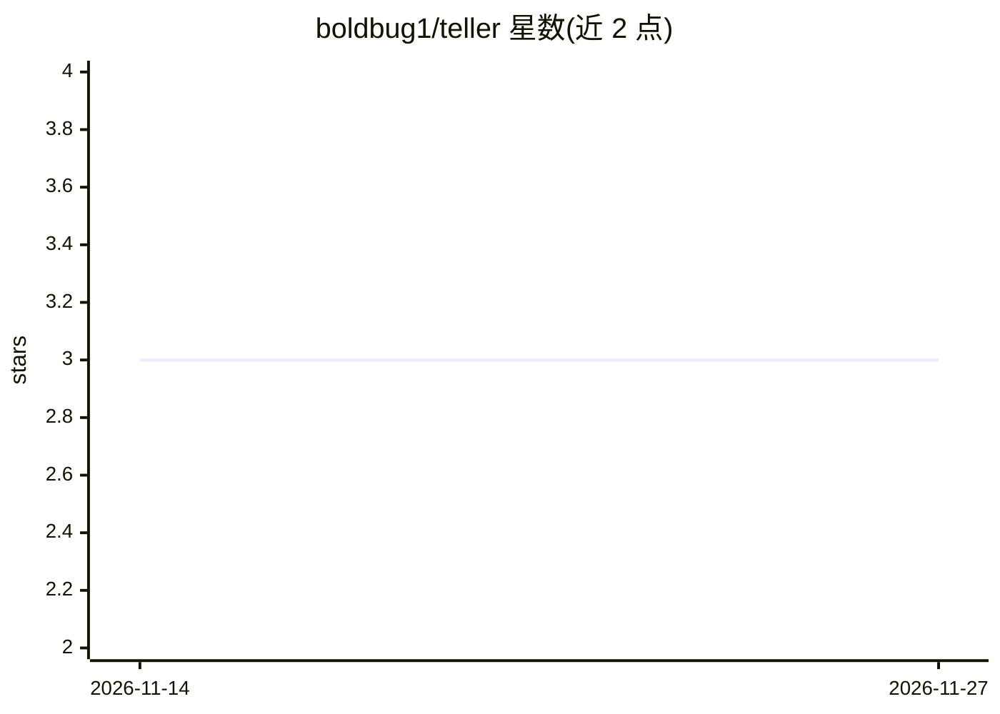

# boldbug1/teller

⭐ 3 · Python · MIT · 推送 2026-11-12 · [GitHub](https://github.com/boldbug1/teller) · 个人维护

**将文本故事转换为多角色语音剧的开源工具**

Teller 读取纯文本故事、书籍和剧本，解析旁白与对话，维护持久的角色表并为每个角色分配独立语音，在播放前合成语音，支持逐词卡拉OK同步高亮，并可将片段拼接导出为单一 WAV 有声书。对话归属支持云端 LLM（Groq、Gemini）与本地 Ollama，也内置无需 API key 的规则引擎；语音合成提供 Kokoro ONNX 离线模型、ElevenLabs 与 Gemini TTS。以 Tauri 桌面应用加 Python CLI 形式提供，含 FastAPI 接口与确定性音频缓存机制。

## 筛选速览

| 维度 | 判定 | 备注 |
|---|---|---|
| AI 角色 | `ai-native` | 本体是模型或模型工具 |
| 许可风险 | `permissive` | MIT |
| 部署形态 | `desktop` | 安装包/桌面程序 |
| 模型依赖 | local-ok | 支持本地模型 |
| 硬件要求 | — | 无带数字的原话,不猜 |
| 安装摩擦 | `low` | 无编译、无系统依赖或容器化 |
| 成熟度 | — | 结构信号不足 |

## 能力要点

- 解析对话归属并按角色分配语音，不修改原文
- 支持 Groq/Gemini 云端、Ollama 本地及无 API key 的规则引擎
- Kokoro ONNX 离线 TTS（约 140 MB INT8 模型）与 ElevenLabs/Gemini 云端合成
- SHA-256 缓存键的确定性音频缓存，避免重复合成

## 适用场景

- 把小说或剧本转成多角色有声剧音频
- 本地离线处理故事文本并合成多语音朗读
- 导出拼接后的完整有声书 WAV 文件

## 场景标签

`语音合成` · 领域:内容生成

## 证据(README 行号)

> L21: Teller turns any story into a full-cast performance. Whether running locally or using cloud models, Teller identifi
> L56: - **Multiple LLM Providers**:

## 星数曲线

2026-11-14 3 → 2026-11-27 3（+0）

---
*卡片 v1 · prompt 1.4 · 生成 2026-11-22 · 置信度 high · 依据 README sha `49406fc8b7c9` · [字段定义](../../DATASET.md)*
