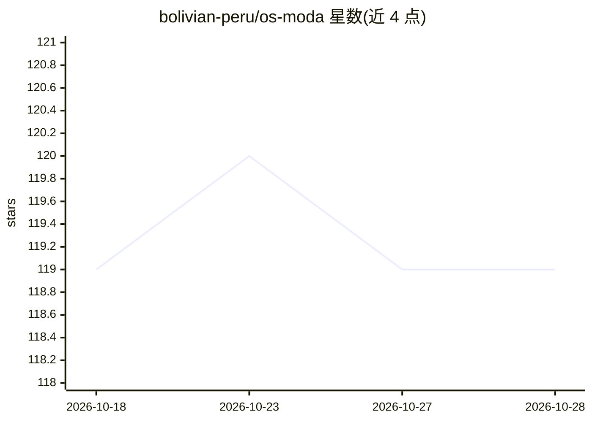

# bolivian-peru/os-moda

⭐ 119 · Rust · Apache-2.0 · 推送 2026-06-24 · [GitHub](https://github.com/bolivian-peru/os-moda) · [官网](https://os.moda) · 个人维护

**面向 AI agent 的 NixOS 操作系统：对话运维服务器，改动可原子回滚**

基于 NixOS 的完整操作系统，让 AI agent 通过 92 个结构化 MCP 工具（10 个 Rust 守护进程）以类型化、可审计的方式操作服务器：健康检查、配置、部署、崩溃恢复，依托 NixOS 世代机制实现每笔系统改动一步回滚。提供哈希链审计账本、加密凭据存储、可热切换的模块化运行时（Claude Code 默认/OpenClaw/托管驱动）。面向独自运维服务器的开发者与小团队。作者自述为研究级单人项目，默认运行时的原生 shell/文件工具尚未接入审批门与审计账本，建议在可丢弃的机器上运行。

## 筛选速览

| 维度 | 判定 | 备注 |
|---|---|---|
| AI 角色 | `ai-ecosystem` | LLM/agent 周边工具 |
| 许可风险 | `permissive` | Apache-2.0 |
| 部署形态 | `None` |  |
| 模型依赖 | locked-api |  |
| 硬件要求 | — | 无带数字的原话,不猜 |
| 安装摩擦 | `low` | 无编译、无系统依赖或容器化 |
| 成熟度 | `idea` | |

## 能力要点

- 92 个结构化工具经 10 个 Rust 守护进程暴露给 agent，不开放原始 shell
- NixOS 原子回滚 + SafeSwitch 健康检查失败自动回滚
- SHA-256 哈希链 append-only 审计账本（agentctl verify-ledger）
- 运行时可热切换（claude-code/openclaw/managed-agent），SIGHUP 零停机

## 适用场景

- 用对话替代 SSH 管理自己的服务器，改错可一键回滚
- 给 AI agent 提供带凭据管理与审计的运行基础设施
- 让 agent 处理例行运维并在无法处理时上报

## 场景标签

 · 领域:基础设施/操作系统

## 证据(README 行号)

> L5: **You operate the server by talking to it.** The agent has typed, audited access to the whole system — health, confi
> L29: - **AI agent builders who need infrastructure** — a place for agents to actually live: credential management, healt
> L145: 10 Rust daemons communicating over Unix sockets. No daemon exposes TCP to the internet (except mesh peer port 1880

## 星数曲线

2026-10-18 119 → 2026-10-28 119（+0）

---
*卡片 v1 · prompt 1.4 · 生成 2026-10-23 · 置信度 high · 依据 README sha `660fc56b9e3a` · [字段定义](../../DATASET.md)*
