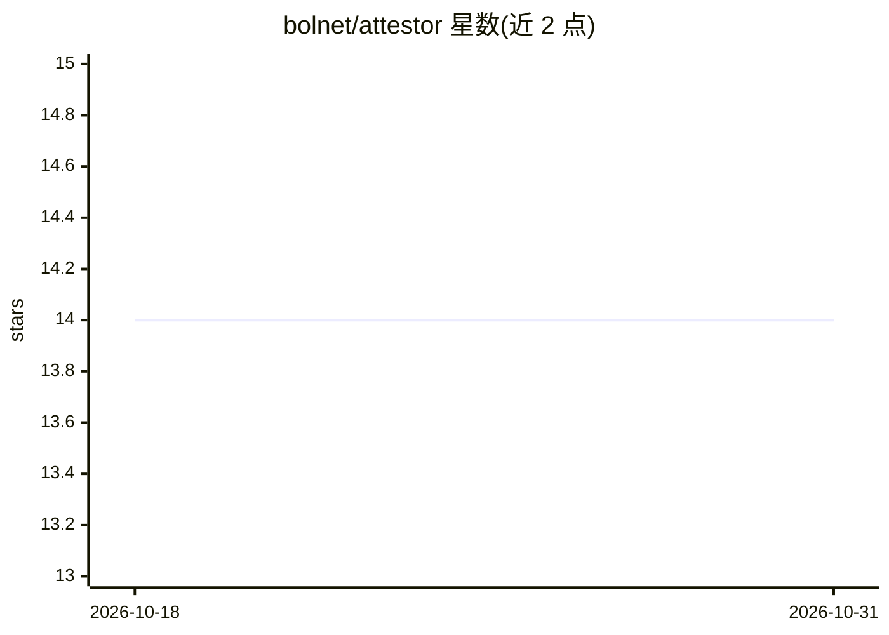

# bolnet/attestor

⭐ 14 · Python · MIT · 推送 2026-09-18 · [GitHub](https://github.com/bolnet/attestor) · [官网](https://attestor.dev) · 个人维护

**面向多智能体团队的可审计治理型记忆服务，自托管**

自托管的共享记忆层，服务由多个不同信任级别的 LLM 智能体共同读写同一记忆的场景：通过 AgentContext 强制执行六种角色的读/写/遗忘权限、每条记忆携带溯源元数据（可选 Ed25519 签名）、按智能体的 token 预算与写入配额、无 LLM 参与的确定性排序路径、可按任意历史时刻回放的时态取代、跨 Postgres/Pinecone/Neo4j 三存储角色的租户隔离，以及审计优先的遗忘与保留流程（Temporal 持久工作流为可选项）。以 Python 库、REST sidecar 或 MCP server 三种形态提供，同一 API。不面向单一编码助手的个人记忆，也不是通用向量库或 RAG 框架。

## 筛选速览

| 维度 | 判定 | 备注 |
|---|---|---|
| AI 角色 | `ai-ecosystem` | LLM/agent 周边工具 |
| 许可风险 | `permissive` | MIT |
| 部署形态 | `desktop` | 安装包/桌面程序 |
| 模型依赖 | local-ok | 支持本地模型 |
| 硬件要求 | — | 无带数字的原话,不猜 |
| 安装摩擦 | `low` | 无编译、无系统依赖或容器化 |
| 成熟度 | — | 结构信号不足 |

## 能力要点

- AgentContext 层的六角色权限模型，违规在触达后端前抛出 PermissionError
- 检索排序（向量→BM25→RRF→图→MMR→预算裁剪）默认无 LLM 参与，结果可重放
- 每条记忆的溯源与可选 Ed25519 签名，forget_user 审计先行、部分成功可见
- Python 库 / REST sidecar / MCP server 同一 API 运行

## 适用场景

- 多智能体产品中许多智能体共享一份记忆并需控制读写权限
- 受监管系统需要按历史时刻重建记忆状态与可辩护的删除记录
- 自托管部署：自己的 VPC、Postgres、Pinecone、Neo4j

## 场景标签

`Agent 记忆` `多智能体` · 领域:Agent 开发

## 证据(README 行号)

> L7: When many agents share one memory, recall is the easy part. The hard part is who may write, who may forget, what an 
> L62: - Multi-agent products where many LLM-driven agents with different trust levels write to the same memory
> L70: - An LLM agent runtime — Attestor is the memory backend; the agent loop is yours

## 星数曲线

2026-10-18 14 → 2026-10-31 14（+0）

---
*卡片 v1 · prompt 1.4 · 生成 2026-10-31 · 置信度 high · 依据 README sha `0bbc796d37a9` · [字段定义](../../DATASET.md)*
